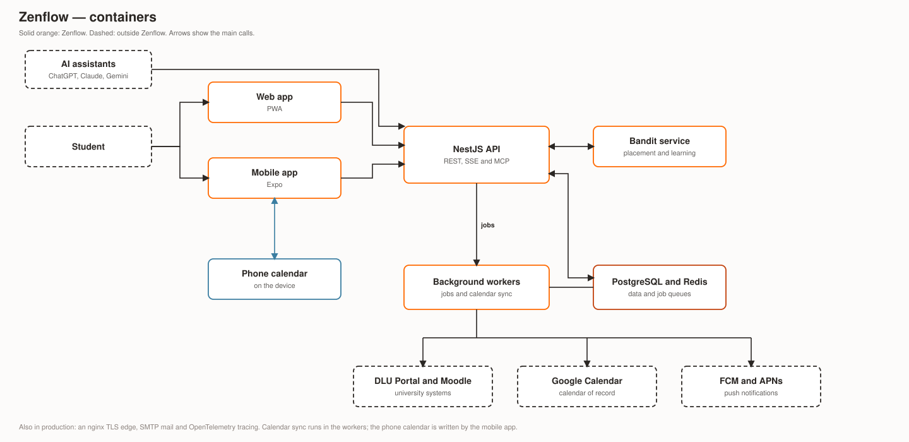
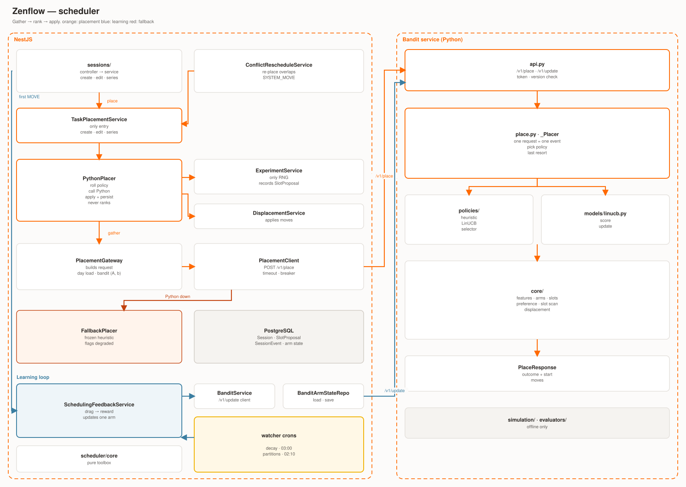
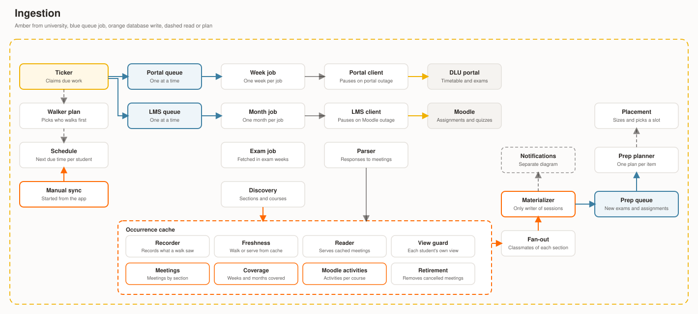
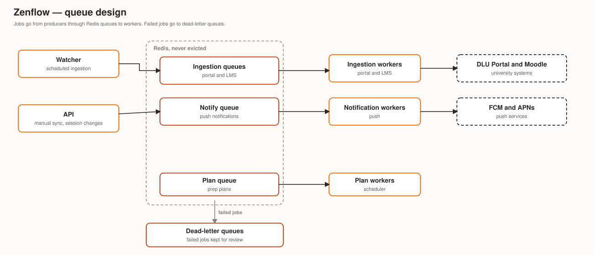
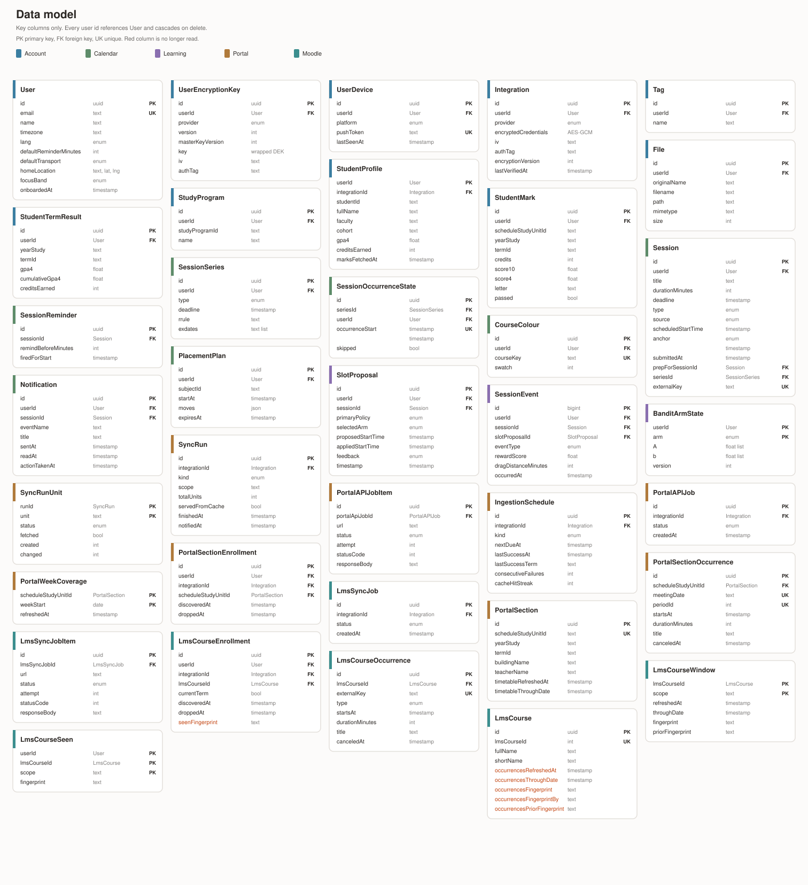

# Zenflow Architecture

Diagram-first companion to [README.md](README.md), for contributors placing a change before reading the detail.

- Conventions and invariants: [AGENTS.md](AGENTS.md)
- Per-app detail: [backend](backend/README.md), [mobile](mobile/README.md), [bandit service](services/bandit/README.md)
- Backend reference: [docs/backend/](docs/backend/)
- Sequence flows: [docs/architecture/scheduler-flows.md](docs/architecture/scheduler-flows.md)
- Decisions behind this shape: [docs/adr/](docs/adr/)
- Guided code reading (backend + bandit): [docs/architecture/backend-trace.html](docs/architecture/backend-trace.html)

## System / container view

- Students use the mobile app, which calls one NestJS API over REST and SSE. AI assistants call the same API over MCP.
- One backend image runs as several processes, picked by `ROLE` ([ADR-0011](docs/adr/0011-separate-api-worker-processes.md)):
  - `api`: HTTP only, scales by replicas, no cron.
  - `watcher`: exactly one, the only cron runner. It enqueues and consumes nothing.
  - `worker-portal`, `worker-lms`, `worker-notify`, `worker-scheduler`: one BullMQ queue each.
  - `all` runs everything in one process (local dev, test stack).
- All placement ranking is delegated to the Bandit service, a stateless Python process called by the API and the watcher.
- Redis is split by workload: sessions/OTP, rate limits (also the manual-sync lock), kill-switch flags, BullMQ jobs, SSE pub/sub ([ADR-0008](docs/adr/0008-redis-topology-and-kill-switch.md)). The `redis-cache` of ADR-0017 is not deployed.
- Ingestion pulls from the university's Portal, DKHP and Moodle systems; push goes out through self-hosted ntfy ([ADR-0047](docs/adr/0047-ntfy-push.md)).
- Production also runs an edge proxy and an observability stack (OTel → Tempo, Loki, Prometheus, Grafana).

## Calendar

- Zenflow to phone: `planSync` creates, updates and deletes Zenflow events on the phone calendar through `expo-adapter`. Only Zenflow-owned types are written.
- Phone to Zenflow: on foreground, `use-device-calendar` compares each phone event with what Zenflow last wrote. Moves and reminders of scheduled TASKs are sent as session updates with origin `DEVICE`; other phone edits are overwritten on the next write.
- Busy time: the phone's other events go to `PUT /device-calendar/busy` and become `Session` rows of type `DND` with source `DEVICE`. They are never written back.
- One calendar target per user (`User.calendarTarget`): `DEVICE` or `NONE`.

## Scheduler components

- The scheduler places exactly one task, or one series, per call and touches nothing else.
- `TaskPlacementService` is the only entry `sessions/` uses. `PythonPlacer` gathers inputs, calls `POST /v1/place`, applies the moves and persists the result.
- `ExperimentService` holds the only RNG: the 50/50 policy roll and the pairwise draw.
- A frozen heuristic (`FallbackPlacer`) answers only when the Bandit service is unavailable; the response is marked degraded, never a 503.
- The Bandit service is the only ranking implementation, reached through `/v1/place` and `/v1/update`.
- Reward: the first user move (API) and a KEPT (kept sweep) call `/v1/update` and persist the arm state. A nightly job decays the preference matrix.

## Ingestion and notifications components

- Connect queues the profile fetch and enrolment discovery. A 5 second watcher then claims due `IngestionSchedule` rows (never-synced first) and splits each into jobs: one per timetable week, one per LMS month; the claim is the at-most-once guard.
- `worker-portal` / `worker-lms` consume one queue per step (profile, marks, discovery, week, month, exam). A week or month is read from the cross-student cache or fetched alone. Clients sit behind per-upstream circuit breakers; responses go to pure parsers.
- `MaterializerService` is the single writer of ingested `Session` rows. A student's own move or delete wins over upstream; a removal soft-deletes.
- The cross-student occurrence cache and fan-out are off by default.
- A materializer write creates one `Notification` row, then `announce()` fans it out twice: Redis pub/sub for live SSE, and one `notify` push job per provider.
- Reminders are not sent by Zenflow. The reminder is written onto the phone calendar event, and that calendar fires it ([ADR-0039](docs/adr/0039-thin-layer-calendar-native.md)).

## Queue design

- Ten queues in four groups: portal ingestion, LMS ingestion, notify and prep-plan. Each has a dead-letter queue, on a `noeviction` + AOF Redis.
- The job id is the idempotency key; every producer call is time-bounded.
- Retries use exponential backoff; an open upstream breaker parks a job without using an attempt.

## Data model

- Source of truth is [`schema.prisma`](backend/prisma/schema.prisma); table notes are in [docs/backend/data-model.md](docs/backend/data-model.md).
- Four areas: account and access, sessions, the learning loop (`SlotProposal`, `SessionEvent`, `BanditArmState`), and ingestion with the portal and LMS catalog.
- The diagram shows key columns only; the full set is in `schema.prisma`.
