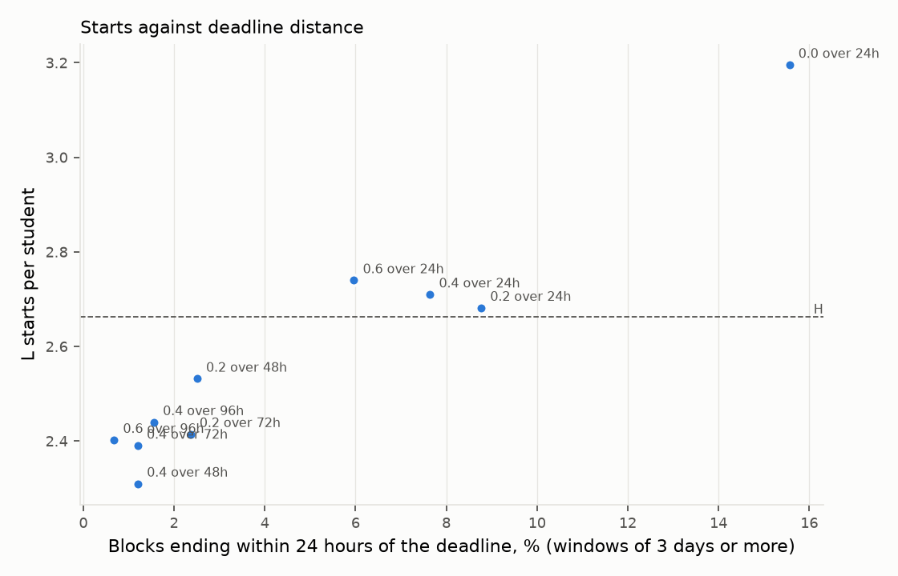

# Report: heuristic vs matrix seeded LinUCB, offline eval

**Context.** Zenflow is a study planner. When a student adds a task, or a new exam or assignment arrives, the app places a study block for it
and may offer one alternative time. Onboarding no longer asks when the student focuses best, so both policies start every student from the same
default preference matrix. Before release we want to know whether a learning policy (LinUCB) places blocks better than the rule based policy
(the heuristic) when both start from that matrix.

We answer this with simulated students, because the live test will have too few users to decide it early ([A/B plan](./ab-testing.md)).
Both policies read the same matrix, so neither has information the other lacks.

This report states every rule of the simulated student, every formula for the policies, and every statistic. Nothing is a black box. The
simulated students are our assumptions, and the report says so wherever it matters.

## Glossary

Read this first. Every table in the report uses these terms.

**The students**

- **Simulated student:** a program that reacts to placements by fixed rules (section 3). There are no real people in this report.
- **True band:** the clock hours `[lo, hi)` in which the student really starts studying, for example 17:00 to 21:00. A block counts as in band when its start hour is inside it.
- **Attention `a`:** the chance that the student opens the Zenflow app during a block's time slot. It is not focus. A start is counted only when the app is opened in the block.
  The chance is `p = a` in general and `p = min(1, a * (1 + imminence))` within 2 days of the deadline (section 3.3). Attention is 0.5 in most worlds.
- **Imminence:** how much more likely the student is to open the app near a deadline. It is 0.5 in every world except the absent student, where it is 0.
- **Drag, tap, ignore:** three ways a student treats a placement: move a block that is in the wrong place, answer the "keep or prefer this time?" offer, or do nothing. A student is one of the three, drawn with probabilities 0.1, 0.6, 0.3.
- **World:** one kind of simulated student: a true band, an attention level, a drag chance and optional changes over time. There are 14 worlds (section 3.2).
- **Attention worlds:** the same 17:00 to 21:00 student at attention 0.05, 0.15, 0.3, 0.6 and 0.9. They show how the result depends on how often a student opens the app.
- **Absent world:** a 17:00 to 21:00 student with attention 0.02, imminence 0 and drag chance 0.05. They almost never open the app, so almost nothing starts under any policy.
- **Routine change world:** a student who studies 17:00 to 21:00 for tasks that arrive in the first 14 days and 06:00 to 10:00 for tasks that arrive after. Nothing in the product announces the change.
- **Weekend world:** a student who studies 17:00 to 21:00 with attention 0.5 on weekdays and 19:00 to 23:00 with attention 0.3 on Saturday and Sunday, later and lazier.

**The policies**

- **Default matrix:** the 7 by 24 table of liking scores shown in section 2.1. Weekdays have a late morning hump and an evening hump with a dip after lunch. Weekends are 0.7 times as high and one hour later.
- **H:** the rule based policy (the heuristic) on the default matrix. It is the control.
- **L:** LinUCB with cold arms seeded from the default matrix (section 2.2). It is the policy this report evaluates.
- **L-cold:** LinUCB with no prior. It shows what the prior adds.
- **L-deadline, L-gap, L-gap-only:** L with the deadline term off, with the old gap term back on, and with the gap term on and the deadline term off. **H-deadline** is H with its deadline term off.
- **Oracle:** the placement with the highest chance of a start (the ceiling). **Rand:** a random placement (the floor).

**The outcomes**

- **Start:** a task counts as started when its block begins inside the student's true band and the student opens the app in it (section 3.3). It is the only outcome that decides a verdict.
- **Starts per student:** the number of a student's 12 tasks that are started (section 4.1).
- **Hours left:** the hours between the end of a placed block and the task's deadline (section 4.7).
- **Within 24h:** the share of blocks that end within 24 hours of the deadline, over tasks whose window is 3 days or more.
- **Pick rate:** among offers the student answered, the share where they chose L's time rather than H's (section 4.4).

## 1. The answer in short

The table counts the 14 worlds by what the main run (100 seeds, 10,000 students per world) shows for L minus H, in starts per student.

| | Worlds | Which |
| --- | --- | --- |
| L clearly better than H | 5 of 14 | 09 to 17; 06 to 10; 13 to 17; 21 to 24; 13 to 15 |
| Level | 0 of 14 | none |
| L slightly worse (under 0.5 starts) | 2 of 14 | attention 0.05; absent |
| L worse (past the margin) | 7 of 14 | 17 to 21; weekend world; attention 0.15; attention 0.3; attention 0.6; attention 0.9; routine change |

The main findings, each explained in the section named:

- The result splits by where the true band sits relative to the matrix. H places blocks at the matrix humps, so it wins for evening students and for the weekend world (L is 2.2 and 2.5 starts behind). L wins for 09 to 17, 06 to 10 and 21 to 24 students, where H's humps miss the band (sections 5.1 and 5.2).
- L is worse than H in 7 worlds by more than the 0.5 margin, mostly the evening based ones. Pooled over the 14 worlds with equal weight, L minus H is -0.64 starts (section 5.1).
- The prior helps L only where the matrix is right. L minus L-cold is positive for the evening, weekend and attention worlds and negative for 09 to 17 (-1.19) and 13 to 17 (-0.74), and slightly negative for 06 to 10 and 21 to 24. L-cold is the best of the three policies in 09 to 17, 06 to 10, 13 to 17 and 21 to 24 (section 5.3).
- No policy starts anything for 13 to 17 and 13 to 15 students. Their band sits in the afternoon lecture slots and the matrix dip, so almost no free in band slot exists (section 5.2).
- The deadline term moves blocks away from the deadline: within 24h falls from 16% to 3% for L. It costs about 0.7 starts averaged over the band worlds, because the simulated student opens the app more near a deadline (sections 5.6 and 5.7).
- The gap term helps the 21 to 24 student (+1.32) and hurts the 09 to 17 student (-0.62). It does not change the distance to the deadline (section 5.6).
- Widening the deadline reach from 24 to 48 hours moves more blocks than raising the weight, so production keeps weight 0.2 and reach 48 hours for LinUCB (section 5.7).
- More students do not change the picture: a 600 student run gives the same verdict in 12 of 14 worlds (section 5.9).
- A placement takes 0.35 ms for H and 0.55 ms for L, and an update takes 0.10 ms (section 5.10).
- The students are invented. The results show how the policies behave under the stated assumptions, not that real students will start more (section 7).


## 2. The two policies

Both policies run the production placement code in process (`tests/test_evalx.py` checks the harness returns exactly what `/v1/place` returns). For each task they
scan every 15 minute start from the arrival day to the deadline that avoids busy time and quiet hours, score each start, and place the block at the highest score.
Quiet hours are a hard limit: no block starts or runs between 23:00 and 06:00.

### 2.1 The heuristic (H)

The heuristic keeps a table `m[w, h]` of liking scores, one per weekday `w` (7) and hour `h` (24). The score of a 60 minute block is the mean of the four
15 minute cell values it covers, plus a deadline penalty:

```text
score(block) = mean of m over the block's cells  -  0.2 * max(0, 1 - hours_left / 24)
```

where `hours_left` is the time between the block's end and the deadline. The highest score wins, and **the earliest block wins a tie**.

- **The default matrix.** Monday to Friday: 0.2 at 06:00 and 07:00, 0.4 at 08:00, 0.8 from 09:00 to 12:00, 0.4 at 12:00, 0.3 from 13:00 to 15:00, 0.6 from 15:00 to 17:00,
  0.5 from 17:00 to 19:00, 0.8 from 19:00 to 22:00, 0.4 at 22:00, and 0 for every other hour. Saturday and Sunday: the weekday value of the hour before, times 0.7.
  The values are assumptions about typical university students. Nothing here is measured, and the matrix should be replaced by a cohort prior once 20 students have data.
- **Learning.** A cell moves by `cell <- clip(cell + 0.2 * delta, -1, 1)`. When a student starts a block, `delta = +0.25` for the block's start cell. When a student moves a
  block, the old cell gets `-g` and the new cell `+g`, where `g = min(1, drag_minutes / 240)`.
- **H-deadline** is the same policy with the penalty term removed.

### 2.2 LinUCB (L)

LinUCB keeps one linear model per time band ("arm"), six in all: 00 to 08, 08 to 11, 11 to 14, 14 to 17, 17 to 20, 20 to 24. Each arm holds a matrix `A` (7 x 7) and a vector `b` (7).
For a candidate day the context `x` has 7 numbers: days to the deadline, task length, days from now, weekend sign (+1 on Saturday and Sunday, -1 otherwise), fixed load (lecture) hours,
flexible load hours, and a constant 1.

```text
theta        = A^-1 b
UCB          = theta . x  +  alpha * sqrt(x^T A^-1 x)               alpha = 0.15
score(block) = sum over arms of  overlap(block, arm) * UCB_arm(day)  -  0.2 * max(0, 1 - hours_left / 48)
```

`overlap(block, arm)` is the fraction of the block inside the arm's hours. The sum picks the band, because it is flat inside one. Several slots in the same band therefore often have exactly the same score, and the tie rule decides the hour.

- **Tie rule.** Among slots with equal score, prefer the arm that comes first in a seeded random order of the five waking arms (early morning is always last), then the start nearest the arm band's centre, then the earlier start.
- **Gap term.** The shipped code once added `0.2 * gap_quality` (free time on each side of the block). It is now off (weight 0). **L-gap** turns it back on.
- **Deadline term.** The penalty above reaches 48 hours before the deadline for LinUCB and 24 hours for the heuristic, with weight 0.2 for both. **L-deadline** removes it.
- **Learning.** After a reward `r` on the arm that placed the block: `A <- A + x x^T` and `b <- b + r x`. Rewards (ADR-0035): a start gives +1; a move gives `-min(1, drag_minutes / 240)`;
  taking or keeping L's option in the pairwise offer gives +0.5; keeping the heuristic's option over it gives -0.2; ignoring gives nothing.
- **The prior.** L-cold starts each arm at `A = I`, `b = 0` (ridge 1). L starts each arm from the default matrix at two reference contexts: a weekday (ISO weekday 3) and a weekend (ISO weekday 6), each with
  mid horizon values for days to the deadline and days from now and a 60 minute task. For arm `a` and context `c`:

  ```text
  share(a, c)  = mean of m over the arm's hours on weekdays (c = weekday) or weekends (c = weekend)  /  max of m
  r(a, c)      = -0.2 + 0.7 * share(a, c)
  A_a          = I  +  0.5 * x_wd x_wd^T  +  0.5 * x_we x_we^T
  b_a          = 0.5 * r(a, wd) * x_wd  +  0.5 * r(a, we) * x_we
  ```

  The pseudo rewards that result:

  | Arm | Weekday share | Weekday reward | Weekend share | Weekend reward |
  | --- | --- | --- | --- | --- |
  | 00 to 08 | 0.06 | -0.16 | 0.02 | -0.19 |
  | 08 to 11 | 0.83 | +0.38 | 0.41 | +0.09 |
  | 11 to 14 | 0.63 | +0.24 | 0.58 | +0.21 |
  | 14 to 17 | 0.63 | +0.24 | 0.35 | +0.05 |
  | 17 to 20 | 0.75 | +0.33 | 0.47 | +0.13 |
  | 20 to 24 | 0.63 | +0.24 | 0.61 | +0.23 |

  The prior is weak on purpose. It weighs 1 pseudo observation in total, so real rewards dominate after a few starts. With a weekday weight of 1 or more, a test student with weekday evening and
  weekend morning habits still misses weekends after six weeks of placements.
- **Reschedules.** Both policies add a stability term when a task already has a start (a reschedule). Every simulated task is new, so the term is zero throughout. Reschedules, such as a deadline change, are not evaluated.

### 2.3 The bounds

- **Oracle:** for each task, among all 15 minute starts inside the student's true band that fit between arrival and deadline, avoid lectures and avoid 02:00 to 06:00, the start with the highest
  start probability `p` (section 3.3), earliest on ties. In expectation no policy can start more tasks than this, so it is the ceiling.
- **Rand:** a random day in the task's window and a random whole hour from 08:00 to 21:00. It ignores lectures, the band and the deadline, so it is the floor.

## 3. The simulated student

### 3.1 Tasks and calendar

Each student gets `N = 12` tasks (3 a week for 4 weeks). Task `t` has these properties:

- It arrives at 08:00 on a day drawn uniformly from the 28 days, and lasts 60 minutes.
- Its deadline is `K` days after arrival, with `K` drawn uniformly from {1, 2, 3, 5, 7}. A task with `K = 1` (20% of tasks) cannot end more than 24 hours before its deadline, which is why the within 24h measure uses only tasks with `K` of 3 or more.
- It carries four random numbers drawn once and shared by every policy (common random numbers): `U_open`, `U_drag`, `U_coin`, `U_see`, uniform on (0, 1), and two standard normal draws used by the pick model.

Each student also has a lecture timetable. For each weekday, a number of lecture bands `k` is drawn (1 with probability 0.2, 2 with 0.6, 3 with 0.2) from three bands:
07:30 to 11:15, 13:00 to 16:30 and 16:45 to 20:00. Each band holds four 50 minute periods, evenly spaced. The timetable is the same every week and Saturday and Sunday are free. Lectures are busy time that no policy may overlap.
Placed tasks do not occupy the calendar.

### 3.2 Parameters

Every value below is an assumption, except the production constants of the policies in section 2.

| Quantity | Value | Where it varies |
| --- | --- | --- |
| Tasks per student | 12 | fixed |
| Task length | 60 minutes | fixed |
| Attention `a` | 0.5 | 0.05, 0.15, 0.3, 0.6, 0.9 in the attention worlds; 0.02 in the absent world; 0.3 on weekends in the weekend world |
| Imminence | 0.5, so `p` is 1.5 times `a` (capped at 1) within 2 days of the deadline | 0 in the absent world |
| Drag chance `q` | 0.3 | 0.05 in the absent world |
| Share of drag, tap, ignore students | 10%, 60%, 30% | sensitivity rows (section 5.8) |
| Pick noise `sigma`, keep bias `beta` | 0.3, 0.15 | fixed until classroom labels exist |
| True band | 09 to 17, 06 to 10, 13 to 17, 17 to 21, 21 to 24, 13 to 15 | the band worlds |

The 14 worlds are the groups we chose to probe. They are not a sample from a population of students.

| Group | Worlds |
| --- | --- |
| Band grid (6) | six true bands, attention 0.5, imminence 0.5, drag 0.3. 13 to 15 sits inside the matrix dip |
| Weekend (1) | band 17 to 21 and attention 0.5 on weekdays; band 19 to 23 and attention 0.3 on Saturday and Sunday |
| Attention sweep (5) | true band 17 to 21, attention 0.05, 0.15, 0.3, 0.6, 0.9 |
| Absent (1) | true band 17 to 21, attention 0.02, imminence 0, drag 0.05 |
| Routine change (1) | true band 17 to 21 for tasks that arrive before day 14 and 06 to 10 after |

How each trait enters the numbers. Let a block start at clock hour `h(s)` on absolute day `D(s)`, with `d(s)` days from the block's start to the deadline.

- Band: `lo, hi = band_on(D(s))`, the weekend band on Saturday and Sunday when the world has one, the weekday band otherwise. For the routine change world the band is chosen by the task's arrival day.
- Attention: `a_D = weekend_attention` on Saturday and Sunday when the world has one, `attention` otherwise.
- Open chance: `p(s) = min(1, a_D * (1 + imminence))` if `d(s) <= 2`, else `p(s) = a_D`.

For example an attention 0.3 student, imminence 0.5, has `p = 0.3` more than 2 days out and `p = 0.45` within 2 days. The absent student has `p = 0.02` always.

### 3.3 When a block starts, and what a bad placement is

Let the student's band on that day be `[lo, hi)`. Define:

```text
in(s)  = 1 if lo <= h(s) < hi, else 0          (only the start hour is tested)
p(s)   = min(1, a_D * (1 + imminence)) if d(s) <= 2, else a_D    (the chance the student opens the app in the block)
```

The task's fixed draw `U_open` is compared with `p`:

- **In band.** The task is started if `U_open < p(s)`.
- **Out of band, ignore or tap student.** The task is not started.
- **Out of band, drag student.** If `U_drag < q` and a free in band start exists on that day (a 15 minute start inside the band, not overlapping a lecture, not in 02:00 to 06:00), the student moves the block to the one
  nearest the band centre. The task is then started if `U_open < p(s)`, with `p` taken from the original slot. Otherwise it is not started.

So the probability that a placed block leads to a start is

```text
P(start | block at s) = in(s) * p(s)                                            ignore and tap students
                      = in(s) * p(s)  +  (1 - in(s)) * q * f(s) * p(s)           drag students (f = 1 if a free in band start exists)
```

**A bad placement, in this report, is a block that starts outside the student's true band.** Its start probability is 0 for 90% of students (the ignore and tap students) and at most `q * p(s)`,
that is 0.3 times `p`, for drag students. A good placement is in band, and a better one is in band and within 2 days of the deadline, because `p` is then 1.5 times larger (unless that is capped at 1).
There is no other notion of quality: no regret, no utility curve, no sleep penalty. This is a simplification, and it decides which policy wins. In particular a student who starts more near a deadline rewards
placements near the deadline, so the deadline term can only look costly here.

A student's score for a policy is the sum of the 12 task outcomes (1 started, 0 not). A task that a policy cannot place counts as not started.

### 3.4 The three kinds of student and the live protocol

Each student is one of three kinds, drawn once with probabilities 0.1, 0.6, 0.3. The draw uses the student's own seed, so every policy sees the same kind.

- **Drag:** may move an out of band block (section 3.3).
- **Tap:** answers the offer in the live protocol below, and does nothing else.
- **Ignore:** never moves a block and never answers an offer.

In the single policy arms only drag students ever change a block. The live protocol (arm **AB**) adds the pairwise offer, with L as the learning policy. For every task:

1. A seeded coin `U_coin < 0.5` makes L the primary policy, otherwise the heuristic (H). Both policies place the task.
2. If the two starts are at least 60 minutes apart, the student is shown the choice. Otherwise there is no offer.
3. A tap student sees the offer with probability `p` of the primary's slot (`U_see < p`). Others never answer. If the offer is not answered the primary's block stands.
4. A tap student who sees it takes the alternative when `u_alt + sigma * e_alt > u_prim + beta + sigma * e_prim`, where `e` are standard normal draws and the utility of a start is
   `u(s) = 1` if `s` is in band, otherwise `-min(1, d / 6)` with `d` the hours from the nearest band edge. This is the probability `Phi((u_alt - u_prim - beta) / (sigma * sqrt(2)))` of taking the alternative.
5. The applied block then goes through the start rule of section 3.3. Learning follows the reward list in section 2.2.

### 3.5 What the student model leaves out

Real students vary in many ways this model does not: a continuous preferred hour, tiredness, how late they start, other commitments, and unequal liking within a band.
The start rule is binary and depends only on the start hour. Exams, assignments and other placed tasks do not occupy the calendar. A weekend differs only through the band and attention of the weekend world; every other world studies the same hours all week.
These choices make the model easy to state and to check, but they are not measured.

## 4. Metrics and statistics

### 4.1 Starts per student

For student `i`, policy `a` and world `w`, the score is

```text
X(a, i) = sum over the 12 tasks of  1[task is started]
```

as defined in section 3.3. The tables report the mean `X-bar(a) = (1/n) * sum X(a, i)` over the `n` students of the world (`n = 10,000` in the main run: 100 seeds with 100 students each).
The mean has no interval by itself, only differences do. Example, world 17 to 21: `X-bar(L) = 3.08`, `X-bar(H) = 5.22`. A mean of 5.22 means the average student starts 5.2 of the 12 tasks.

### 4.2 The difference between two policies, and why pairing matters

For two policies `A` and `B` on the same student:

```text
D(i) = X(A, i) - X(B, i)         D-bar = (1/n) * sum D(i)
```

Both policies get the same student: the same tasks, the same calendar, the same kind of student and the same random numbers `U_open`, `U_drag`, `U_coin`, `U_see`. Only the placements differ. This is called pairing.

Worked example, L minus H, world 17 to 21, `n = 10,000`:

- `D-bar = -2.15`. The standard deviation of `D` is 2.76 and the standard error is `2.76 / sqrt(10000) = 0.028`.
- `D(i) > 0` for 16% of students, `D(i) = 0` for 15%, and `D(i) < 0` for 69%.
- Pairing matters: `X(L)` and `X(H)` have standard deviations of 3.00 and 2.27 and are correlated at 0.48, so `D` has a standard deviation of 2.76. Without pairing the standard error would be
  `sqrt(9.02 + 5.17) / sqrt(10000) = 0.038`, 1.4 times larger.

### 4.3 How the intervals are established

All intervals are 95% percentile bootstrap intervals with 2,000 resamples and a fixed random seed, so a rerun gives the same numbers. A difference is printed as
`mean [lo, hi] / [lo, hi]`. There are two intervals because there are two ways the result could differ in a new run.

**Interval over students (the first bracket).**

1. Take the `n` values `D(1), ..., D(n)`.
2. Draw `n` values from them with replacement and compute their mean. Repeat 2,000 times.
3. Report the 2.5th and 97.5th percentiles of the 2,000 means.

It answers: how much would the mean change with a different draw of students from the same world? Check against theory: the normal theory interval `-2.15 +/- 1.96 * 0.028` is [-2.20, -2.09]. The bootstrap gives [-2.20, -2.09].

**Interval over seeds (the second bracket).**

1. Split the 10,000 students into the 100 seeds of 100. Compute each seed's mean of `D`. These 100 values lie between -2.87 and -1.38 in the example, with standard deviation 0.29.
2. Draw 100 values from them with replacement and take their mean. Repeat 2,000 times.
3. Report the 2.5th and 97.5th percentiles.

It answers: how much would the mean change in a new run of 100 seeds? Students are independent draws, so this interval is a consistency check on the first. The two agree throughout the report, which is what independent students predict.

**Rates (offered, tapped, pick, start by primary policy).** Each is a ratio of sums over students, for example the pick rate `sum(picks_i) / sum(taps_i)`. The interval resamples whole students with replacement, recomputes the ratio, and takes the
2.5th and 97.5th percentiles. Resampling students, not individual offers, accounts for several offers coming from one student.

**What the intervals do not cover.** They measure sampling variation only. They do not cover the assumptions of section 3: a different student model would shift the means by far more than any interval shows. No p values are reported, and no correction for
looking at 14 worlds is applied, because the verdicts are read from the size of the effect and not from a test.

### 4.4 The offer metrics

These come from the live protocol (arm AB), counted over every task of every student in a world. In the example world there are 120,000 events (100 seeds x 100 students x 12 tasks).

| Metric | Definition | Example, world 17 to 21 |
| --- | --- | --- |
| Offered rate | events with an offer / all events. An offer needs the two starts to be at least 60 minutes apart. | 92% |
| Tapped rate | offers answered / offers shown. Only tap students answer, and only when they see it. | 38% |
| Pick rate | answered offers where the student chose L's block / answered offers. 50% means no preference. | 39% |
| Start, L primary | events with L as primary policy whose applied block was started / events with L as primary. | 34% |
| Start, heuristic primary | the same for events with the heuristic as primary. | 46% |

The pick rate is the simulated counterpart of the classroom labelling session. It depends on the assumed choice model (section 3.4), so it is a consistency check on the start results and not a result of its own.

### 4.5 The verdict, and the margin

The margin is 0.5 starts per student, about one task in 24. It is our judgement of what a student would notice. The verdict for a difference `L - H` uses the wider of the two intervals:

- **better** if both ends are above 0;
- **worse** if both ends are below 0 and the lower end is below -0.5;
- **slightly worse** if both ends are below 0 and the lower end is above -0.5;
- **level** if the interval includes 0.

"Better" and "worse" describe the sign of a difference that is distinguishable from sampling noise. They do not say the difference is large: a world can be "better" by 0.03 starts.

### 4.6 Checks run before any result is read

`tests/test_evalx.py` checks that the harness places exactly what `/v1/place` places, that the rewards equal the backend constants, that a seed reruns to identical output, that a policy compared with itself differs
by exactly 0, that Oracle is at least every other policy and Rand is below the learning policy, that with no keep bias the pick is a fair coin, that weekend traits apply on weekends only, and that every arm's settings are restored after a placement.

### 4.7 Deadline distance

For every placed block, `hours_left = (deadline - block end) / 1 hour`. A student's value is the mean over their placed blocks, and the tables report the mean over students.
`Within 24h` is the share of placed blocks with `hours_left <= 24`, over tasks whose window (deadline minus arrival) is at least 3 days. Shorter windows are left out because a task with `K = 1` or `K = 2` cannot be placed more than 24 or 48 hours before its deadline.
The placement diagnostic in section 5.2 measures the same distance from the block's start instead of its end, over every task, so its values differ.
The distance is reported for every arm and has no verdict: the student model above rewards a smaller distance, so it cannot say whether a larger one is better.

## 5. Results

### 5.1 L against the heuristic on the same matrix (H)

This section subtracts H's starts per student from L's, world by world, on the same students and draws. H is the right control because it reads the same matrix as L's prior.
A positive difference means L starts more tasks. Both intervals and the verdict follow sections 4.3 and 4.5.

| World | H | L | L minus H | Verdict |
|---|---|---|---|---|
| 09 to 17 | 4.09 | 5.26 | +1.17 [+1.10, +1.24] / [+1.10, +1.24] | better |
| 06 to 10 | 3.31 | 5.10 | +1.80 [+1.76, +1.83] / [+1.76, +1.83] | better |
| 13 to 17 | 0.10 | 0.12 | +0.03 [+0.02, +0.04] / [+0.02, +0.03] | better |
| 17 to 21 | 5.22 | 3.08 | -2.15 [-2.20, -2.09] / [-2.21, -2.09] | worse |
| 21 to 24 | 0.31 | 1.43 | +1.12 [+1.09, +1.16] / [+1.09, +1.16] | better |
| 13 to 15 | 0.10 | 0.11 | +0.01 [+0.00, +0.02] / [+0.00, +0.02] | better |
| weekend world | 5.22 | 2.75 | -2.47 [-2.52, -2.42] / [-2.52, -2.42] | worse |
| attention 0.05 | 0.46 | 0.19 | -0.27 [-0.28, -0.26] / [-0.29, -0.26] | slightly worse |
| attention 0.15 | 1.44 | 0.68 | -0.77 [-0.79, -0.74] / [-0.79, -0.74] | worse |
| attention 0.3 | 3.02 | 1.60 | -1.42 [-1.45, -1.38] / [-1.45, -1.38] | worse |
| attention 0.6 | 6.34 | 3.90 | -2.44 [-2.50, -2.38] / [-2.51, -2.38] | worse |
| attention 0.9 | 8.19 | 5.26 | -2.93 [-3.01, -2.86] / [-3.01, -2.85] | worse |
| absent | 0.15 | 0.05 | -0.10 [-0.11, -0.10] / [-0.11, -0.10] | slightly worse |
| routine change | 3.52 | 2.92 | -0.60 [-0.63, -0.56] / [-0.63, -0.57] | worse |

- The 13 to 17 and 13 to 15 differences are +0.03 and +0.01: both policies start about 0.1 tasks out of 12, so the clear verdict is a tiny effect.
- The attention 0.05 and 0.15 worlds and the absent world are small in size even when the sign is clear, because few tasks start under any policy.

### 5.2 Where the policies place blocks

Section 5.1 gives the result but not the reason. This section measures where each policy puts its blocks. For each world, 200 students (seed 0, ignore style so no block is moved) place their 12 tasks. The tables report the share of blocks that start
inside the student's true band, the mean start hour, and the share that start within 2 days of their deadline. The code is `python -m evalx.diagnose`.

| World | In band, H | In band, L-cold | In band, L | Mean start hour, H | Mean start hour, L-cold | Mean start hour, L |
|---|---|---|---|---|---|---|
| 09 to 17 | 49% | 88% | 69% | 14.4 | 11.8 | 11.1 |
| 06 to 10 | 41% | 66% | 64% | 14.4 | 9.7 | 11.1 |
| 13 to 17 | 0% | 11% | 0% | 15.6 | 12.5 | 12.4 |
| 17 to 21 | 70% | 22% | 44% | 16.4 | 13.1 | 13.7 |
| 21 to 24 | 0% | 22% | 19% | 15.6 | 14.0 | 14.2 |
| 13 to 15 | 0% | 0% | 0% | 15.6 | 12.4 | 12.4 |
| weekend world | 70% | 17% | 42% | 16.4 | 13.0 | 14.1 |
| attention 0.05 | 63% | 10% | 23% | 15.7 | 12.5 | 12.5 |
| attention 0.15 | 65% | 14% | 31% | 15.9 | 12.7 | 12.9 |
| attention 0.3 | 68% | 17% | 38% | 16.2 | 12.9 | 13.4 |
| attention 0.6 | 70% | 23% | 47% | 16.5 | 13.2 | 13.9 |
| attention 0.9 | 71% | 28% | 49% | 16.5 | 13.4 | 14.1 |
| absent | 62% | 9% | 22% | 15.6 | 12.5 | 12.5 |
| routine change | 44% | 33% | 37% | 16.2 | 12.2 | 13.4 |

Share of blocks that start within 2 days of the deadline, where `p` is boosted:

| World | H | L-cold | L | L-deadline |
|---|---|---|---|---|
| 09 to 17 | 55% | 49% | 52% | 61% |
| 06 to 10 | 55% | 49% | 53% | 61% |
| 13 to 17 | 47% | 43% | 49% | 61% |
| 17 to 21 | 55% | 44% | 52% | 61% |
| 21 to 24 | 47% | 42% | 49% | 58% |
| 13 to 15 | 47% | 41% | 49% | 61% |
| weekend world | 55% | 44% | 53% | 60% |
| attention 0.05 | 48% | 42% | 50% | 61% |
| attention 0.15 | 51% | 43% | 51% | 61% |
| attention 0.3 | 54% | 43% | 51% | 61% |
| attention 0.6 | 56% | 44% | 52% | 60% |
| attention 0.9 | 57% | 45% | 52% | 60% |
| absent | 48% | 42% | 49% | 61% |
| routine change | 55% | 46% | 53% | 61% |

What the tables show:

- **17 to 21, weekend and attention worlds.** H places 70% of blocks in band, at the evening hump (mean start hour 16.4), because the earliest highest scoring block is 19:00. L places 44% in band and L-cold 22%, with mean start hours of 13.8 and 13.1.
  L's prior ranks 08 to 11 first (reward +0.38) and 17 to 20 second (+0.33), and 12 tasks give too few starts to correct it. This is why H is ahead by 2 to 3 starts in these worlds.
- **09 to 17 and 06 to 10.** H places 49% and 41% in band and L 69% and 64%, because H goes to the evening hump (mean start hour 14.4) while L favours the morning arm. L-cold places 88% of 09 to 17 blocks in band and is the best policy there (6.45 starts).
- **13 to 17 and 13 to 15.** Nobody places blocks in band: H 0%, L 0%, L-cold 11% and 0%. The afternoon lectures (13:00 to 16:30) and the matrix dip leave almost no free in band slot, so even Oracle only reaches 7.1 starts.
- **21 to 24.** H places 0% in band and L 19%. L-cold places 22% and starts the most (1.52). Quiet hours begin at 23:00, so only 21:00 and 22:00 starts count.
- **Routine change.** H places 44% in band and L 37%, over the whole run, since neither policy is told about the change.
- **Within 2 days of the deadline.** L places 49% to 53% of blocks there, H 47% to 57%, and L-deadline 58% to 61%. The deadline term moves blocks out of the window where `p` is boosted.

### 5.3 What the prior adds (L against L-cold)

This section compares L with L-cold, LinUCB without a prior. The only difference is the matrix seeded pseudo observations, so the difference is the value of the prior. Each difference reads `mean [95% CI over students] / [95% CI over seeds]`.

| World | L-cold | L | L minus L-cold | Verdict |
|---|---|---|---|---|
| 09 to 17 | 6.45 | 5.26 | -1.19 [-1.24, -1.14] / [-1.24, -1.14] | worse |
| 06 to 10 | 5.18 | 5.10 | -0.08 [-0.13, -0.03] / [-0.13, -0.03] | slightly worse |
| 13 to 17 | 0.86 | 0.12 | -0.74 [-0.78, -0.69] / [-0.77, -0.70] | worse |
| 17 to 21 | 1.59 | 3.08 | +1.49 [+1.42, +1.56] / [+1.43, +1.55] | better |
| 21 to 24 | 1.52 | 1.43 | -0.09 [-0.13, -0.06] / [-0.13, -0.06] | slightly worse |
| 13 to 15 | 0.11 | 0.11 | -0.01 [-0.01, +0.00] / [-0.01, +0.00] | level |
| weekend world | 1.14 | 2.75 | +1.61 [+1.55, +1.66] / [+1.56, +1.66] | better |
| attention 0.05 | 0.07 | 0.19 | +0.12 [+0.11, +0.13] / [+0.11, +0.12] | better |
| attention 0.15 | 0.29 | 0.68 | +0.39 [+0.37, +0.41] / [+0.37, +0.41] | better |
| attention 0.3 | 0.77 | 1.60 | +0.83 [+0.79, +0.87] / [+0.79, +0.88] | better |
| attention 0.6 | 2.08 | 3.90 | +1.81 [+1.74, +1.90] / [+1.74, +1.89] | better |
| attention 0.9 | 3.37 | 5.26 | +1.89 [+1.80, +1.99] / [+1.80, +1.99] | better |
| absent | 0.02 | 0.05 | +0.03 [+0.02, +0.03] / [+0.02, +0.03] | better |
| routine change | 2.61 | 2.92 | +0.31 [+0.28, +0.35] / [+0.28, +0.35] | better |

- The prior helps where the matrix matches the student: 17 to 21 (+1.49), the weekend world (+1.61), the attention worlds (+0.12 at attention 0.05 up to +1.89 at 0.9) and the routine change (+0.31).
- It hurts 09 to 17 (-1.19) and 13 to 17 (-0.74): the prior ranks 08 to 11 first and 11 to 14 and 14 to 17 below it, and a cold model finds the student's hours from the first starts instead.
- It costs 0.09 for 21 to 24 and 0.08 for 06 to 10, and is level for 13 to 15, where nothing starts.
- L-cold is the best of the three policies in 09 to 17 (6.45), 06 to 10 (5.18, level with L at 5.10), 13 to 17 (0.86) and 21 to 24 (1.52). It is the worst in the evening, weekend and attention worlds.

### 5.4 Every arm, starts per student

This section prints the mean starts per student of every arm in every world, so any pair can be compared. There are no differences or intervals here. Read each row between Rand (the floor) and Oracle (the ceiling). Bold italic marks the best of the three policies.

| World | H | L-cold | L | Oracle | Rand |
|---|---|---|---|---|---|
| 09 to 17 | 4.09 | ***6.45*** | 5.26 | 9.03 | 4.71 |
| 06 to 10 | 3.31 | ***5.18*** | 5.10 | 9.03 | 1.35 |
| 13 to 17 | 0.10 | ***0.86*** | 0.12 | 7.10 | 2.40 |
| 17 to 21 | ***5.22*** | 1.59 | 3.08 | 9.03 | 2.47 |
| 21 to 24 | 0.31 | ***1.52*** | 1.43 | 9.03 | 0.80 |
| 13 to 15 | 0.10 | ***0.11*** | 0.11 | 7.10 | 1.27 |
| weekend world | ***5.22*** | 1.14 | 2.75 | 8.46 | 2.08 |
| attention 0.05 | ***0.46*** | 0.07 | 0.19 | 0.89 | 0.24 |
| attention 0.15 | ***1.44*** | 0.29 | 0.68 | 2.70 | 0.73 |
| attention 0.3 | ***3.02*** | 0.77 | 1.60 | 5.42 | 1.47 |
| attention 0.6 | ***6.34*** | 2.08 | 3.90 | 10.83 | 2.96 |
| attention 0.9 | ***8.19*** | 3.37 | 5.26 | 12.00 | 3.58 |
| absent | ***0.15*** | 0.02 | 0.05 | 0.24 | 0.07 |
| routine change | ***3.52*** | 2.61 | 2.92 | 9.03 | 1.92 |


### 5.5 The pairwise offer

This section reports the live protocol of section 3.4 for the same students, with L as the learning policy. Its purpose is to check whether the simulated students' stated choice between the two policies' times agrees with the start results. The metrics are defined and worked in section 4.4.
A pick rate above 50% favours L's time.

| World | Offered | Tapped | L pick rate | Start, L primary | Start, H primary |
|---|---|---|---|---|---|
| 09 to 17 | 88% [88, 88] | 39% [38, 40] | 60% [60, 61] | 47% [46, 47] | 43% [43, 44] |
| 06 to 10 | 85% [84, 85] | 40% [39, 40] | 63% [62, 64] | 36% [36, 37] | 32% [31, 32] |
| 13 to 17 | 90% [89, 90] | 39% [39, 40] | 65% [65, 66] | 5% [4, 5] | 3% [3, 4] |
| 17 to 21 | 92% [91, 92] | 38% [37, 39] | 39% [38, 39] | 34% [34, 35] | 46% [46, 47] |
| 21 to 24 | 85% [85, 85] | 38% [37, 39] | 61% [60, 61] | 17% [16, 17] | 12% [11, 12] |
| 13 to 15 | 90% [89, 90] | 39% [39, 40] | 70% [70, 71] | 2% [2, 2] | 2% [2, 2] |
| weekend world | 92% [91, 92] | 35% [35, 36] | 36% [35, 37] | 30% [30, 31] | 44% [44, 45] |
| attention 0.05 | 86% [86, 87] | 4% [4, 4] | 29% [28, 31] | 2% [2, 2] | 4% [4, 4] |
| attention 0.15 | 89% [88, 89] | 12% [11, 12] | 33% [32, 34] | 6% [6, 7] | 12% [12, 12] |
| attention 0.3 | 91% [90, 91] | 23% [23, 23] | 36% [36, 37] | 17% [16, 17] | 26% [26, 26] |
| attention 0.6 | 92% [92, 92] | 46% [45, 47] | 39% [39, 40] | 44% [44, 45] | 57% [56, 57] |
| attention 0.9 | 93% [92, 93] | 57% [57, 58] | 39% [39, 40] | 62% [61, 62] | 74% [73, 74] |
| absent | 85% [84, 85] | 1% [1, 1] | 25% [23, 28] | 0% [0, 0] | 1% [1, 1] |
| routine change | 91% [91, 91] | 39% [38, 39] | 45% [44, 45] | 28% [27, 28] | 33% [32, 33] |

- The pick rate is above 50% in 5 of 14 worlds. It is above 50% in 09 to 17, 06 to 10, 13 to 17, 21 to 24 and 13 to 15, and below 50% in the evening, weekend, attention, absent and routine change worlds.
- Pick rate and starts agree in 09 to 17, 06 to 10, 21 to 24 and every world where H starts more. In 13 to 17 and 13 to 15 the pick rate is 65% and 70% but both policies start about 0.1 tasks, so the choice compares two bad options.
- Most offers are not answered. At attention 0.05 only 4% are, so few picks reach L.
- Where the matrix hump is right H also wins the primary start rate (46% against 34% in 17 to 21), which is the same result as section 5.1 from a different counting.

### 5.6 What the gap and deadline terms add, and whether they change the distance to the deadline

This section removes each term in turn. Section 5.1 used production settings: no gap term and a deadline term of weight 0.2 and reach 48 hours. L-deadline removes the deadline term, L-gap adds the old gap term, and L-gap-only has the gap term without the deadline term.

Effect on starts, `mean [95% CI over students] / [95% CI over seeds]`:

| World | Gap term (L-gap minus L) | Deadline term (L minus L-deadline) |
|---|---|---|
| 09 to 17 | -0.62 [-0.65, -0.59] / [-0.65, -0.59] | -0.21 [-0.28, -0.14] / [-0.28, -0.14] |
| 06 to 10 | +0.02 [+0.01, +0.02] / [+0.01, +0.02] | -0.33 [-0.35, -0.31] / [-0.35, -0.31] |
| 13 to 17 | +0.00 [+0.00, +0.01] / [+0.00, +0.01] | +0.05 [+0.04, +0.06] / [+0.04, +0.05] |
| 17 to 21 | -0.01 [-0.02, -0.01] / [-0.01, -0.01] | -0.25 [-0.29, -0.21] / [-0.28, -0.21] |
| 21 to 24 | +1.32 [+1.28, +1.35] / [+1.28, +1.36] | -3.63 [-3.69, -3.57] / [-3.69, -3.57] |
| 13 to 15 | +0.02 [+0.01, +0.02] / [+0.01, +0.02] | +0.04 [+0.03, +0.05] / [+0.03, +0.04] |
| weekend world | -0.06 [-0.07, -0.05] / [-0.07, -0.05] | -0.33 [-0.37, -0.30] / [-0.37, -0.30] |
| attention 0.05 | -0.00 [-0.00, -0.00] / [-0.00, -0.00] | -0.02 [-0.03, -0.01] / [-0.02, -0.01] |
| attention 0.15 | -0.01 [-0.01, -0.00] / [-0.01, -0.00] | -0.07 [-0.08, -0.06] / [-0.08, -0.05] |
| attention 0.3 | -0.01 [-0.01, -0.01] / [-0.01, -0.01] | -0.15 [-0.17, -0.12] / [-0.17, -0.12] |
| attention 0.6 | -0.01 [-0.02, -0.01] / [-0.02, -0.01] | -0.27 [-0.32, -0.23] / [-0.32, -0.23] |
| attention 0.9 | -0.01 [-0.02, -0.01] / [-0.02, -0.01] | -0.14 [-0.19, -0.09] / [-0.19, -0.09] |
| absent | -0.00 [-0.00, +0.00] / [-0.00, +0.00] | -0.00 [-0.01, -0.00] / [-0.01, -0.00] |
| routine change | +0.01 [+0.01, +0.02] / [+0.01, +0.02] | -0.25 [-0.27, -0.23] / [-0.27, -0.22] |

Distance to the deadline: mean hours left and share within 24h (windows of 3 days or more). H and H-deadline are the heuristic with and without its penalty (24 hour reach).

| World | H | H-deadline | L | L-deadline | L-gap | L-gap-only |
|---|---|---|---|---|---|---|
| 09 to 17 | 62 h, 11% | 62 h, 11% | 66 h, 4% | 57 h, 15% | 65 h, 4% | 57 h, 15% |
| 06 to 10 | 62 h, 11% | 62 h, 11% | 64 h, 6% | 57 h, 15% | 63 h, 6% | 57 h, 15% |
| 13 to 17 | 71 h, 5% | 71 h, 5% | 65 h, 0% | 55 h, 17% | 65 h, 0% | 55 h, 17% |
| 17 to 21 | 59 h, 8% | 55 h, 15% | 63 h, 3% | 55 h, 16% | 62 h, 3% | 55 h, 16% |
| 21 to 24 | 71 h, 5% | 71 h, 5% | 64 h, 1% | 55 h, 13% | 63 h, 1% | 55 h, 13% |
| 13 to 15 | 71 h, 5% | 71 h, 5% | 65 h, 0% | 55 h, 17% | 65 h, 0% | 55 h, 17% |
| weekend world | 59 h, 8% | 55 h, 15% | 62 h, 4% | 54 h, 15% | 61 h, 4% | 54 h, 15% |
| attention 0.05 | 68 h, 5% | 67 h, 7% | 64 h, 1% | 55 h, 17% | 64 h, 1% | 55 h, 17% |
| attention 0.15 | 65 h, 6% | 62 h, 10% | 64 h, 2% | 55 h, 17% | 63 h, 2% | 55 h, 16% |
| attention 0.3 | 62 h, 6% | 58 h, 13% | 63 h, 2% | 55 h, 16% | 63 h, 3% | 55 h, 16% |
| attention 0.6 | 58 h, 8% | 54 h, 15% | 63 h, 3% | 55 h, 15% | 62 h, 3% | 55 h, 15% |
| attention 0.9 | 57 h, 9% | 53 h, 16% | 62 h, 4% | 55 h, 15% | 62 h, 4% | 55 h, 15% |
| absent | 70 h, 5% | 70 h, 5% | 65 h, 0% | 55 h, 17% | 64 h, 0% | 55 h, 17% |
| routine change | 60 h, 8% | 56 h, 14% | 63 h, 4% | 55 h, 15% | 62 h, 4% | 55 h, 15% |

- Removing the deadline term moves L's blocks toward the deadline in every world: hours left fall from 62 to 66 down to 54 to 57 and the share within 24h rises from 0% to 6% up to 13% to 17%. The term does what it was built for.
- It costs starts: -0.00 to -0.33 in eleven worlds, +0.04 and +0.05 in the two afternoon worlds, and -3.63 in the 21 to 24 world, where without it 59% of blocks start in band against 19% with it. The simulated student opens the app more near a deadline, so the student model rewards what the term avoids.
- Adding the gap term changes the distance by under 2 hours in every world, so gap quality is unrelated to deadline distance.
- The gap term helps the 21 to 24 student (+1.32) and hurts the 09 to 17 student (-0.62). Everywhere else its effect is within 0.06 of zero, so it is off.
- H's own penalty (24 hours, weight 0.2) matters only where H places blocks near the deadline, the evening hump worlds: H ends 59 hours before the deadline against 55 without the penalty (8% against 15% within 24h) and starts 0.22 more tasks in 17 to 21. In the other worlds H and H-deadline differ by under 3 hours and 0.05 starts.

### 5.7 The deadline weight and reach

This section sweeps the weight and the reach of LinUCB's deadline term, to see which one moves blocks away from the deadline. It uses seeds 0 to 19 with 100 students per world, averaged over the seven band worlds (six bands and the weekend world).
H uses the weight and its own 24 hour reach in every row.

| Weight and reach | H starts | H hours left | L starts | L hours left | L within 24h |
|---|---|---|---|---|---|
| off, reach 24h | 2.66 | 63.7 | 3.20 | 55.1 | 16% |
| 0.2, reach 24h | 2.60 | 64.8 | 2.68 | 59.5 | 9% |
| 0.4, reach 24h | 2.57 | 65.4 | 2.71 | 60.0 | 8% |
| 0.6, reach 24h | 2.48 | 67.6 | 2.74 | 60.7 | 6% |
| 0.2, reach 48h | 2.60 | 64.8 | 2.53 | 63.7 | 3% |
| 0.4, reach 48h | 2.57 | 65.4 | 2.31 | 65.6 | 1% |
| 0.2, reach 72h | 2.60 | 64.8 | 2.41 | 67.4 | 2% |
| 0.4, reach 72h | 2.57 | 65.4 | 2.39 | 69.1 | 1% |
| 0.4, reach 96h | 2.57 | 65.4 | 2.44 | 71.5 | 2% |
| 0.6, reach 96h | 2.48 | 67.6 | 2.40 | 72.7 | 1% |



- Raising the weight alone does little: at reach 24 hours, weight 0.2 to 0.6 moves within 24h from 9% to 6% and hours left from 59.5 to 60.7.
- The reach is the lever: weight 0.2 at reach 48 hours gives 3% within 24h and 63.7 hours left, and reach 72 or 96 hours gives 1% to 2%.
- Starts fall as the reach grows, from 3.20 (term off) to 2.53 at reach 48 and about 2.4 beyond. H is 2.5 to 2.7 in the same worlds.
- Production uses weight 0.2 and reach 48 hours. It has the most starts of the settings that bring within 24h below 4%, and cuts the share from 16% to 3%.

### 5.8 Sensitivity to the assumptions

This section changes one assumption per row and reports L minus H, the pick rate, and L's starts and distance again, to see whether the verdict survives. It uses seeds 100 to 109 with 1,000 students per world, averaged over the seven band worlds (six bands and the weekend world, equal weight).
The pick rate is pooled over the same worlds. The averages hide which world drives them, so compare rows with each other and do not read the level.

| Row | What changes | L minus H | Pick rate | L starts | L hours left | L within 24h |
|---|---|---|---|---|---|---|
| production | Production settings: 10% drag, 60% tap, 30% ignore; alpha 0.15; heuristic as shipped | -0.07 [-0.11, -0.03] / [-0.12, -0.02] | 56% [55, 57] | 2.52 | 64.0 | 2% |
| mix: drag_only | Every student is a dragger | +0.08 [+0.04, +0.13] / [+0.02, +0.14] | n/a | 3.98 | 63.1 | 3% |
| mix: move_heavy | 60% drag, 10% tap, 30% ignore | +0.02 [-0.02, +0.07] / [-0.03, +0.07] | 56% [54, 58] | 3.34 | 63.5 | 3% |
| mix: ignore_heavy | 10% drag, 20% tap, 70% ignore | -0.07 [-0.11, -0.03] / [-0.12, -0.02] | 57% [56, 59] | 2.52 | 64.0 | 2% |
| alpha 0.05 | Exploration weight alpha 0.05 (shipped 0.15) | -0.06 [-0.10, -0.02] / [-0.10, -0.02] | 56% [56, 57] | 2.53 | 64.0 | 3% |
| alpha 0.5 | Exploration weight alpha 0.5 | -0.15 [-0.20, -0.11] / [-0.20, -0.11] | 51% [51, 52] | 2.44 | 67.3 | 1% |
| heuristic rate 0.05 | Heuristic table learning rate 0.05 (shipped 0.2) | +0.01 [-0.03, +0.06] / [-0.04, +0.06] | 57% [56, 58] | 2.52 | 64.0 | 2% |
| heuristic rate 0.5 | Heuristic table learning rate 0.5 | -0.17 [-0.22, -0.13] / [-0.22, -0.12] | 55% [55, 56] | 2.52 | 64.0 | 2% |
| heuristic rate 2 | Heuristic table learning rate 2 | -0.23 [-0.28, -0.19] / [-0.28, -0.19] | 55% [54, 55] | 2.52 | 64.0 | 2% |
| heuristic kept weight 0 | A kept or started slot adds 0 to the table (shipped 0.25) | +0.39 [+0.35, +0.43] / [+0.35, +0.43] | 59% [58, 60] | 2.52 | 64.0 | 2% |
| heuristic kept weight 1 | A kept or started slot adds 1 | -0.14 [-0.18, -0.09] / [-0.19, -0.09] | 55% [54, 56] | 2.52 | 64.0 | 2% |
| prior strength 0.5 and 0.5 (ships) | Prior weight 0.5 at the weekday and 0.5 at the weekend context | -0.07 [-0.11, -0.03] / [-0.12, -0.02] | 56% [55, 57] | 2.52 | 64.0 | 2% |
| gap weight 0.2 (old) | Gap term back on at 0.2 | +0.02 [-0.02, +0.06] / [-0.03, +0.07] | 56% [55, 56] | 2.61 | 63.3 | 3% |
| deadline term off | Deadline term off | +0.53 [+0.48, +0.57] / [+0.49, +0.57] | 57% [56, 58] | 3.19 | 55.3 | 16% |
| deadline reach 24h (old) | LinUCB deadline reach 24 hours instead of 48 | +0.10 [+0.05, +0.14] / [+0.06, +0.13] | 56% [56, 57] | 2.69 | 59.8 | 9% |
| prior strength 1 and 0.5 | Prior weight 1 and 0.5 | -0.08 [-0.13, -0.04] / [-0.12, -0.04] | 56% [55, 57] | 2.51 | 63.5 | 4% |
| prior strength 2 and 1 | Prior weight 2 and 1 | -0.07 [-0.12, -0.03] / [-0.12, -0.03] | 56% [55, 57] | 2.52 | 63.0 | 4% |
| prior strength 4 and 2 | Prior weight 4 and 2 | -0.07 [-0.12, -0.03] / [-0.11, -0.03] | 56% [55, 56] | 2.52 | 62.7 | 5% |

- Starts follow the share of dragging students, because in the single policy arms only drag students act.
- Alpha from 0.05 to 0.5 moves L minus H by at most 0.08 from the production -0.07. A larger alpha explores more and ends 3 hours further from the deadline.
- The heuristic's learning knobs now matter. A learning rate of 0.5 and 2 moves L minus H to -0.17 and -0.23 (H gets better by learning the evening hours faster), and a kept weight of 0 moves it to +0.39 (H gets worse without learning from starts).
- The prior weight (0.5 and 0.5 up to 4 and 2) changes L minus H by at most 0.01 and L's hours left by up to 1.3.
- The gap term at 0.2 moves L minus H to +0.02, the deadline term off to +0.53 and the old reach of 24 hours to +0.10. The deadline term is the setting that changes the verdict, and it changes L's starts from 2.52 to 3.19.


### 5.9 Does the sample size matter?

This section reruns the main comparison with 600 students per world (30 seeds with 20 students each) and sets it beside the 10,000 student main run. It shows how much of the result is sampling noise.
The width is the upper minus the lower end of the interval over students.

| World | L minus H, 10,000 | Width | Verdict | L minus H, 600 | Width | Verdict |
|---|---|---|---|---|---|---|
| 09 to 17 | +1.17 | 0.14 | better | +1.11 | 0.55 | better |
| 06 to 10 | +1.80 | 0.07 | better | +1.78 | 0.29 | better |
| 13 to 17 | +0.03 | 0.02 | better | +0.03 | 0.07 | level |
| 17 to 21 | -2.15 | 0.11 | worse | -2.09 | 0.43 | worse |
| 21 to 24 | +1.12 | 0.07 | better | +1.12 | 0.27 | better |
| 13 to 15 | +0.01 | 0.01 | better | -0.00 | 0.04 | level |
| weekend world | -2.47 | 0.10 | worse | -2.34 | 0.40 | worse |
| attention 0.05 | -0.27 | 0.02 | slightly worse | -0.30 | 0.10 | slightly worse |
| attention 0.15 | -0.77 | 0.04 | worse | -0.76 | 0.18 | worse |
| attention 0.3 | -1.42 | 0.07 | worse | -1.43 | 0.30 | worse |
| attention 0.6 | -2.44 | 0.13 | worse | -2.31 | 0.51 | worse |
| attention 0.9 | -2.93 | 0.15 | worse | -2.77 | 0.62 | worse |
| absent | -0.10 | 0.01 | slightly worse | -0.10 | 0.05 | slightly worse |
| routine change | -0.60 | 0.07 | worse | -0.55 | 0.28 | worse |

- The width is 0.01 to 0.15 at 10,000 students and 0.04 to 0.62 at 600, about 4.0 times wider, as the square root of the sample ratio (4.1) predicts for the standard error.
- The means move by 0.16 or less.
- 12 of 14 verdicts are identical. Changes: 13 to 17 is level at 600 and better at 10,000 (+0.03 and +0.03); 13 to 15 is level at 600 and better at 10,000 (-0.00 and +0.01).
- More students narrow the intervals and leave the conclusions as they are. What limits the report is the assumed student, not the sample size.

### 5.10 Time per placement and update

This section times the production code on the path the eval runs: `run_place` for a placement (validate the request, build features, score every arm, scan slots) and `update_arm` for a learning step (hydrate the arm, add the rank one update).
It plays 30 students in each of the 7 band worlds serially, one thread, in process, so there is no HTTP, database or queue. The first 10 calls are dropped as warm up. The machine is an Apple silicon laptop.
The code is `python -m evalx.bench`.

| Step | Calls | Mean ms | p50 ms | p95 ms | p99 ms |
|---|---|---|---|---|---|
| Heuristic placement | 2510 | 0.35 | 0.31 | 0.59 | 0.61 |
| LinUCB placement | 2510 | 0.54 | 0.51 | 0.78 | 0.85 |
| LinUCB update | 856 | 0.10 | 0.10 | 0.11 | 0.12 |

A placement scans every 15 minute start of the window, so its cost grows with the window, up to 30 days. A request over HTTP adds JSON and network time that this table leaves out.

## 6. What the results mean

**Why H beats L for the evening student.** H's table has its second hump at 19:00 to 22:00 and the earliest highest block wins, so 70% of its blocks start in a 17 to 21 band. L's prior ranks the 08 to 11 arm first and spreads blocks over the day, and 12 tasks are too few starts to correct it (section 5.2).
The same matrix helps H and costs L, so the matrix is worth more to the heuristic than to LinUCB.

**Why L beats H for 09 to 17, 06 to 10 and 21 to 24.** H places blocks at the evening hump, so it misses these bands. L spreads over the day and places 69%, 64% and 19% in band. L-cold does better still in 09 to 17 and 21 to 24.
The result flips with the true band, so no single world decides the verdict. The worlds are chosen, so the pooled -0.64 is not a population average.

**The prior only helps where the matrix is right.** A matrix that says "morning and evening" helps the students who study then, and hurts a student whose band sits in a dip or an afternoon lecture slot.
No cohort data exists yet, so this matrix is an assumption. Replace it with a cohort prior at 20 students with data.

**The deadline term trades starts for distance in this model.** It keeps blocks away from the deadline (section 5.6) and costs starts, because the simulated student opens the app more near a deadline. The reach, not the weight, decides how far (section 5.7).
Whether real students study better with more time left is not in this model.

**Weekends.** The prior at a weekend context adds +1.61 starts to the weekend world, which is built to match its shape. A real weekend need not follow a 0.7 scale and a one hour shift.

## 7. Verdict

**The offline eval supports a modest statement:** against a heuristic that reads the same default matrix, L is better in 5 of 14 worlds, level in 0, slightly worse in 2 and worse in 7, with the clearest losses in the evening and weekend worlds.

- LinUCB with the matrix prior is not shown to beat the heuristic. It wins where the heuristic's humps miss the student and loses where they hit it.
- Cold LinUCB beats both in 09 to 17, 06 to 10, 13 to 17 and 21 to 24, so the prior is the part that costs.
- The matrix, not the learning policy, is the larger lever: it is what puts H ahead for evening students.
- Production keeps the matrix prior for LinUCB because it is the only warm start available without a stated band, and it starts from the same matrix as the heuristic. The live test, not this eval, should decide between them.
- Keep the deadline term at weight 0.2 with 48 hour reach. It moves blocks off the deadline at a cost of about 0.7 simulated starts averaged over the band worlds.
- Keep gap quality off.
- The simulated pick rate is below 50% in the worlds where H starts more, so the classroom pick rate is the evidence to wait for (section 5.5).

**What would change this:** a classroom pick rate well above 50% for L, a cohort prior fitted from real starts, or fitted student parameters that move the assumptions in section 3.2. The sensitivity run shows the start result moves with the share of students who drag and with the deadline term.

**Limits.**

- The students are simulated. Band, attention, drag share and the pick model are assumptions, not fitted to data (section 3.5).
- The default matrix is an assumption about typical students. No measured hourly data was found for Gen Z or Vietnamese university students.
- A start is binary and depends on the start hour only. It does not model how late a student starts, or how well they study.
- Lectures fill the calendar. Exams, assignments and placed tasks do not.
- The worlds are chosen, not a sample of a population, and several share the same 17 to 21 band.
- 12 tasks per student over 4 weeks is a short horizon for a learner.
- Reschedules and deadline changes are not simulated, so the stability term is untested. The hybrid model is not included.
- Timings are one machine, in process.
- The main run reproduces from `uv run python -m evalx run --seeds 100 --students 100`; the 600 student check is `--seeds 30 --students 20`. The diagnostic is `uv run python -m evalx.diagnose`, the sweeps are `evalx sensitivity` and `evalx deadline`, and the timing is `evalx.bench`. Protocol: [eval-protocol.md](./eval-protocol.md).
