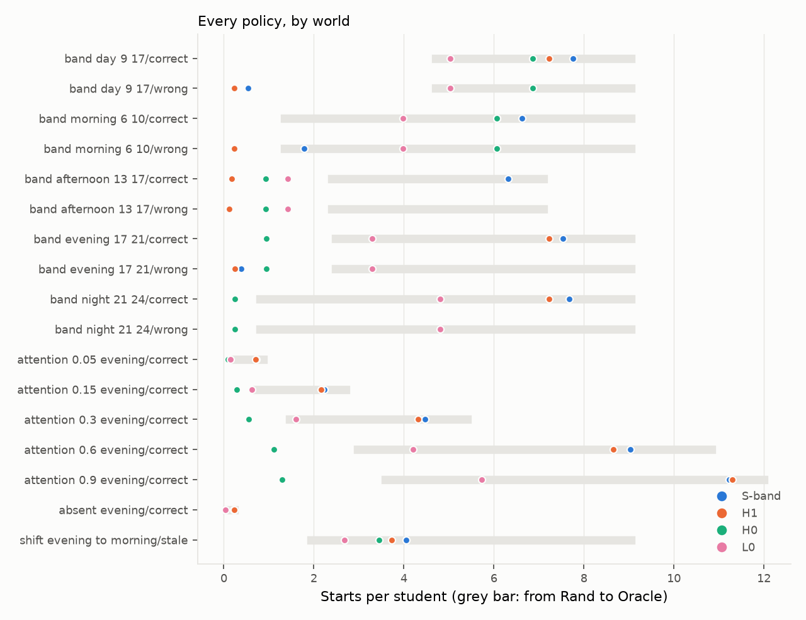

# Report: heuristic vs LinUCB (S-band), offline eval with a same-band control

**Context.** Zenflow is a study planner. When a student adds a task, or a new exam or assignment arrives, the app places a study block for it
and may offer one alternative time. Before release we want to know whether a learning policy (LinUCB) places blocks better than the rule-based
policy (the heuristic).

We answer this with simulated students, because the live test will have too few users to decide it early ([A/B plan](./ab-testing.md)). The comparison
is made fair on purpose: LinUCB uses the focus band the student states at onboarding, so the heuristic is started from the same band.

This report states every rule of the simulated student, every formula for the two policies, and every statistic. Nothing is a black box. The
simulated students are our assumptions, and the report says so wherever it matters.

## Glossary

Read this first. Every table in the report uses these terms.

**The students**

- **Simulated student:** a program that reacts to placements by fixed rules (section 3). There are no real people in this report.
- **True band:** the clock hours in which the student really starts studying, for example 17:00 to 21:00.
- **Stated band:** the answer given at onboarding to "when do you focus best?": morning (08 to 12), afternoon (12 to 17), evening (17 to 21) or late night (21 to 02). Both policies use it.
- **Correct** means the stated band is the one whose centre is nearest the true band's centre (a 17 to 21 student says "evening"). **Wrong** means the one whose
  centre is farthest (the same student says "morning"). Both are tested, because real students may misreport.
- **Attention** is the chance that the student opens the Zenflow app during a block's time slot. It is not focus. A start is counted only when the app is opened in the block.
- **Drag, tap, ignore** are three ways a student treats a placement: move a block that is in the wrong place, answer the "keep or prefer this time?" offer, or do nothing.
- **World:** one kind of simulated student: a true band, a stated band and an attention level.

**The policies and bounds**

- **H0:** the rule-based policy (the heuristic) with the default favourite-hours table. It stands for a student who skipped onboarding.
- **H1:** the heuristic started from the stated band. It is the fair rival, because it gets the same information as LinUCB. It models the production baseline, since the backend seeds the table from the stated band.
- **L0:** LinUCB with no stated band.
- **S-band:** LinUCB with the stated band, with the gap and deadline terms removed and one explicit tie rule (section 2.2). It is the policy this report evaluates. It is a proposed simplification, not the shipped code.
- **Oracle:** the placement with the highest chance of a start (the ceiling). **Rand:** a random placement (the floor).

**The outcomes**

- **Start:** a task counts as started when its block begins inside the student's true band and the student opens the app in it (section 3.3). It is the only outcome this eval counts.
- **Starts per student:** the number of a student's 12 tasks that are started (section 4.1).
- **Pick rate:** among offers the student answered, the share where they chose S-band's time rather than the heuristic's (section 4.4).

## 1. The answer in short

The table counts the 17 worlds by what the main run (50 seeds, 5,000 students per world) shows for S-band minus H1, in starts per student.

| | Worlds | Which |
| --- | --- | --- |
| S-band clearly better than H1 | 14 of 17 | 09 to 17 (correct); 09 to 17 (wrong); 6 to 10 (correct); 6 to 10 (wrong); 13 to 17 (correct); 17 to 21 (correct); 17 to 21 (wrong); 21 to 24 (correct); 21 to 24 (wrong); attention 0.05; attention 0.15; attention 0.3; attention 0.6; routine change |
| Level | 1 of 17 | 13 to 17 (wrong) |
| S-band slightly worse (under 0.5 starts) | 2 of 17 | attention 0.9; absent |
| S-band worse (past the margin) | 0 of 17 | none |

The main findings, each explained in the section named:

- S-band is better than the same-band heuristic in 14 worlds and never worse past the margin. The gains are mostly small: 5 of the 14 are under 0.2 starts, 7 are 0.2 to 0.6, and two are larger, 6 to 10, wrong (+1.56) and 13 to 17, correct (+6.15) (sections 5.1 and 5.2).
- The largest gain exists because H1 places every block at 12:00, outside the afternoon student's 13:00 to 17:00 band. S-band places 83% of its blocks in band (section 5.2).
- Most of the other gains are timing. In the 09 to 17 world both policies place every block in band, and S-band places more blocks within 2 days of the deadline, where the assumed student is likelier to open the app (section 5.2).
- Against the policies that ignore the stated band (H0 and L0), S-band wins when the band is right and loses when it is wrong (section 5.3).
- The stated-band prior is what LinUCB adds. It is worth +2.6 to +4.9 starts when the band is right and costs 1.3 to 4.6 when it is wrong (section 5.3).
- The heuristic's learning rate, kept-slot weight and band trust (0 to 0.8) change nothing at this horizon. Ignoring the band altogether does (section 5.6).
- More students do not change the picture: a 600-student run gives the same verdict in 14 of 17 worlds (section 5.7).
- S-band's tie rule was designed after seeing a failure in this simulation, so the result is not independent evidence for it (section 2.2).
- The students are invented. The results show how the policies behave under the stated assumptions, not that real students will start more (section 7).


## 2. The two policies

Both policies run the production placement code in process (`tests/test_evalx.py` checks the harness returns exactly what `/v1/place` returns), with S-band's changes described in section 2.2. For each task they
scan every 15-minute start from the arrival day to the deadline that avoids busy time and quiet hours, score each start, and place the block at the highest score.

### 2.1 The heuristic (H0 and H1)

The heuristic keeps a table `m[w, h]` of liking scores, one per weekday `w` (7) and hour `h` (24). The score of a 60-minute block is the mean of the four
15-minute cell values it covers, plus a deadline penalty:

```text
score(block) = mean of m over the block's cells  -  0.2 * max(0, 1 - hours_left / 24)
```

where `hours_left` is the time between the block's end and the deadline. The highest score wins, and **the earliest block wins a tie**.

- **H0** starts from the default table, the same on every weekday: 1.0 for 09:00 to 11:00, 0.5 for 14:00 to 16:00, 0.2 for 19:00 to 21:00, and 0 for every other hour.
- **H1** starts from the stated band: `m = 1.0` for hours inside it on every weekday, `m = 0.2` outside.
- **Learning.** A cell moves by `cell <- clip(cell + 0.2 * delta, -1, 1)`. When a student starts a block, `delta = +0.25` for the block's start cell. When a student moves a
  block, the old cell gets `-g` and the new cell `+g`, where `g = min(1, drag_minutes / 240)`.
- H1 scores the same with and without the deadline penalty in every world we tried: the heuristic already picks the earliest in-band block, and the penalty only lowers the score of blocks near the deadline.

### 2.2 LinUCB (L0 and S-band)

LinUCB keeps one linear model per time band ("arm"), six in all: 00 to 08, 08 to 11, 11 to 14, 14 to 17, 17 to 20, 20 to 24. Each arm holds a matrix `A` (7 x 7) and a vector `b` (7).
For a candidate day the context `x` has 7 numbers: days to the deadline, task length, days from now, weekend sign, fixed load (lectures) hours, flexible load hours, and a constant 1.

```text
theta        = A^-1 b
UCB          = theta . x  +  alpha * sqrt(x^T A^-1 x)               alpha = 0.15
score(block) = sum over arms of  overlap(block, arm) * UCB_arm(day)
```

`overlap(block, arm)` is the fraction of the block inside the arm's hours. The sum picks the band, because it is flat inside one. Several slots in the same band therefore often have exactly the same score, and the tie rule decides the hour.

- **S-band's tie rule.** Among slots with equal score, prefer a start inside the stated band, and then the earlier start. It replaces the shipped three-step rule (seeded band order, then distance from the band's centre, then earlier start).
- **What S-band removes from the shipped LinUCB.** The shipped score adds `0.2 * gap_quality` (free time on each side of the block) and subtracts a deadline penalty `0.2 * max(0, 1 - hours_left / 24)`. S-band sets both weights to 0.
- **Why these choices.** An earlier version of this eval (commit `21fe3df3`) compared the shipped version with each part removed. Removing the deadline term helped in 13 of 17 worlds, and the gap term helped only the night student. A variant with only an earliest-start tie rule (arm S-min, commit `1145eb8f`) then scored 0.25 starts for the night student against 7.2 for H1, so we added the stated-band step.
  We designed the rule after seeing that failure in these same worlds, so the results below are not independent evidence for it.
- **Learning.** After a reward `r` on the arm that placed the block: `A <- A + x x^T` and `b <- b + r x`. Rewards (ADR-0035): a start gives +1; a move gives `-min(1, drag_minutes / 240)`;
  taking or keeping S-band's option in the pairwise offer gives +0.5; keeping the heuristic's option over it gives -0.2; ignoring gives nothing.
- **L0** starts each arm at `A = I`, `b = 0` (ridge 1). **S-band** starts each arm from the stated band: `A = I + 3 x_ref x_ref^T`, `b = 3 r_arm x_ref`, where `x_ref` is a fixed
  mid-horizon context and `r_arm = -0.2 + 0.7 * share`, with `share` the fraction of the arm's hours inside the stated band. An arm inside the band starts at +0.5, an arm outside at -0.2,
  each worth 3 pseudo-observations.
- The shipped LinUCB has no preference-table term, and neither has S-band. The heuristic's table is used only by the heuristic.
- Quiet hours are a hard limit: no block starts or runs between 23:00 and 06:00 (02:00 to 09:00 for a late-night stated band).
- **Reschedules.** Both policies add a stability term when a task already has a start (a reschedule). Every simulated task is new, so the term is zero throughout. Reschedules, such as a deadline change, are not evaluated.

### 2.3 The bounds

- **Oracle:** for each task, among all 15-minute starts inside the student's true band that fit between arrival and deadline, avoid lectures and avoid 02:00 to 06:00, the start with the highest
  start probability `p` (section 3.3), earliest on ties. In expectation no policy can start more tasks than this, so it is the ceiling.
- **Rand:** a random day in the task's window and a random whole hour from 08:00 to 21:00. It ignores lectures, the band and the deadline, so it is the floor.

## 3. The simulated student

### 3.1 Tasks and calendar

Each student gets `N = 12` tasks (3 a week for 4 weeks). Task `t` has these properties:

- It arrives at 08:00 on a day drawn uniformly from the 28 days, and lasts 60 minutes.
- Its deadline is `K` days after arrival, with `K` drawn uniformly from {1, 2, 3, 5, 7}.
- It carries four random numbers drawn once and shared by every policy (common random numbers): `U_open`, `U_drag`, `U_coin`, `U_see`, uniform on (0, 1), and two standard normal draws used by the pick model.

Each student also has a lecture timetable. For each weekday, a number of lecture bands `k` is drawn (1 with probability 0.2, 2 with 0.6, 3 with 0.2) from three bands:
07:30 to 11:15, 13:00 to 16:30 and 16:45 to 20:00. Each band holds four 50-minute periods, evenly spaced. The timetable is the same every week. Lectures are busy time that no policy may overlap.
Placed tasks do not occupy the calendar.

### 3.2 Parameters

Every value below is an assumption, except the production constants of the policies in section 2.

| Quantity | Value | Where it varies |
| --- | --- | --- |
| Tasks per student | 12 | fixed |
| Task length | 60 minutes | fixed |
| Attention `a` | 0.5 in the band grid | 0.05, 0.15, 0.3, 0.6, 0.9 in the attention worlds; 0.02 in the absent world |
| Deadline boost | `a` is multiplied by 1.5 (capped at 1) within 2 days of the deadline | fixed |
| Drag chance `q` | 0.3 | fixed |
| Share of drag, tap, ignore students | 10%, 60%, 30% | sensitivity rows (section 5.6) |
| Pick noise `sigma`, keep bias `beta` | 0.3, 0.15 | fixed until classroom labels exist |
| True band | 09 to 17, 06 to 10, 13 to 17, 17 to 21, 21 to 24 | the band worlds |
| Stated band | correct or wrong (see the Glossary) | the band worlds |

The 17 worlds are the groups we chose to probe. They are not a sample from a population of students.

| Group | Worlds |
| --- | --- |
| Band grid (10) | five true bands, each with a correct and a wrong stated band, attention 0.5 |
| Attention sweep (5) | true band 17 to 21, correct stated band, attention 0.05, 0.15, 0.3, 0.6, 0.9 |
| Absent (1) | true band 17 to 21, correct stated band, attention 0.02 |
| Routine change (1) | true band 17 to 21 for the first 14 days and 06 to 10 after, stated band evening throughout |

### 3.3 When a block starts, and what a bad placement is

Let a block start at clock hour `h(s)` on its day, and let `d(s)` be the days from the block's start to the deadline. The student's true band is `[lo, hi)`. Define:

```text
in(s)  = 1 if lo <= h(s) < hi, else 0          (only the start hour is tested)
p(s)   = min(1, a * 1.5) if d(s) <= 2, else a    (the chance the student opens the app in the block)
```

The task's fixed draw `U_open` is compared with `p`:

- **In band.** The task is started if `U_open < p(s)`.
- **Out of band, ignore or tap student.** The task is not started.
- **Out of band, drag student.** If `U_drag < q` (0.3) and a free in-band start exists on that day (a 15-minute start inside the band, not overlapping a lecture, not in 02:00 to 06:00), the student moves the block to the one
  nearest the band centre. The task is then started if `U_open < p(s)`, with `p` taken from the original slot. Otherwise it is not started.

So the probability that a placed block leads to a start is

```text
P(start | block at s) = in(s) * p(s)                                            ignore and tap students
                      = in(s) * p(s)  +  (1 - in(s)) * q * f(s) * p(s)           drag students (f = 1 if a free in-band start exists)
```

**A bad placement, in this report, is a block that starts outside the student's true band.** Its start probability is 0 for 90% of students (the ignore and tap students) and at most `q * p(s)`,
that is 0.3 times `p`, for drag students. A good placement is in band, and a better one is in band and within 2 days of the deadline, because `p` is then 1.5 times larger (unless that is capped at 1).
There is no other notion of quality: no regret, no utility curve, no sleep penalty. This is a simplification, and it decides which policy wins.

A student's score for a policy is the sum of the 12 task outcomes (1 started, 0 not). A task that a policy cannot place counts as not started.

### 3.4 The three kinds of student and the live protocol

Each student is one of three kinds, drawn once with probabilities 0.1, 0.6, 0.3. The draw uses the student's own seed, so every policy sees the same kind.

- **Drag:** may move an out-of-band block (section 3.3).
- **Tap:** answers the offer in the live protocol below, and does nothing else.
- **Ignore:** never moves a block and never answers an offer.

In the single-policy arms only drag students ever change a block. The live protocol (arm **AB-band**) adds the pairwise offer, with S-band as the learning policy. For every task:

1. A seeded coin `U_coin < 0.5` makes S-band the primary policy, otherwise the heuristic (H1). Both policies place the task.
2. If the two starts are at least 60 minutes apart, the student is shown the choice. Otherwise there is no offer.
3. A tap student sees the offer with probability `p` of the primary's slot (`U_see < p`). Others never answer. If the offer is not answered the primary's block stands.
4. A tap student who sees it takes the alternative when `u_alt + sigma * e_alt > u_prim + beta + sigma * e_prim`, where `e` are standard normal draws and the utility of a start is
   `u(s) = 1` if `s` is in band, otherwise `-min(1, d / 6)` with `d` the hours from the nearest band edge. This is the probability `Phi((u_alt - u_prim - beta) / (sigma * sqrt(2)))` of taking the alternative.
5. The applied block then goes through the start rule of section 3.3. Learning follows the reward list in section 2.2.

### 3.5 What the student model leaves out

Real students vary in many ways this model does not: a continuous preferred hour, weekday and weekend differences, tiredness, how late they start, other commitments, and unequal liking within a band.
The start rule is binary and depends only on the start hour. Exams, assignments and other placed tasks do not occupy the calendar. These choices make the model easy to state and to check, but they are not measured.

## 4. Metrics and statistics

### 4.1 Starts per student

For student `i`, policy `a` and world `w`, the score is

```text
X(a, i) = sum over the 12 tasks of  1[task is started]
```

as defined in section 3.3. The tables report the mean `X-bar(a) = (1/n) * sum X(a, i)` over the `n` students of the world (`n = 5,000` in the main run: 50 seeds with 100 students each).
The mean has no interval by itself, only differences do. Example, world 09 to 17 with a correct band: `X-bar(S-band) = 7.76`, `X-bar(H1) = 7.23`. A mean of 7.23 means the average student starts 7.2 of the 12 tasks.

### 4.2 The difference between two policies, and why pairing matters

For two policies `A` and `B` on the same student:

```text
D(i) = X(A, i) - X(B, i)         D-bar = (1/n) * sum D(i)
```

Both policies get the same student: the same tasks, the same calendar, the same kind of student and the same random numbers `U_open`, `U_drag`, `U_coin`, `U_see`. Only the placements differ. This is called pairing.

Worked example, S-band minus H1, world 09 to 17 with a correct band, `n = 5,000`:

- `D-bar = 0.531`. The standard deviation of `D` is 0.739 and the standard error is `0.739 / sqrt(5000) = 0.0105`.
- `D(i) > 0` for 41% of students, `D(i) = 0` for 59%, and `D(i) < 0` for 0%.
- Pairing matters: `X(S-band)` and `X(H1)` have standard deviations of 1.64 and 1.68 but are correlated at 0.90, so `D` has a standard deviation of only 0.74. Without pairing the standard error would be
  `sqrt(2.70 + 2.81) / sqrt(5000) = 0.033`, 3.2 times larger.

### 4.3 How the intervals are established

All intervals are 95% percentile bootstrap intervals with 2,000 resamples and a fixed random seed, so a rerun gives the same numbers. A difference is printed as
`mean [lo, hi] / [lo, hi]`. There are two intervals because there are two ways the result could differ in a new run.

**Interval over students (the first bracket).**

1. Take the `n` values `D(1), ..., D(n)`.
2. Draw `n` values from them with replacement and compute their mean. Repeat 2,000 times.
3. Report the 2.5th and 97.5th percentiles of the 2,000 means.

It answers: how much would the mean change with a different draw of students from the same world? Check against theory: the normal-theory interval `0.531 +/- 1.96 * 0.0105` is [0.510, 0.551]. The bootstrap gives [0.510, 0.551].

**Interval over seeds (the second bracket).**

1. Split the 5,000 students into the 50 seeds of 100. Compute each seed's mean of `D`. These 50 values lie between 0.41 and 0.71 in the example, with standard deviation 0.066.
2. Draw 50 values from them with replacement and take their mean. Repeat 2,000 times.
3. Report the 2.5th and 97.5th percentiles.

It answers: how much would the mean change in a new run of 50 seeds? Students are independent draws, so this interval is a consistency check on the first. The two agree throughout the report, which is what independent students predict.

**Rates (offered, tapped, pick, start by primary policy).** Each is a ratio of sums over students, for example the pick rate `sum(picks_i) / sum(taps_i)`. The interval resamples whole students with replacement, recomputes the ratio, and takes the
2.5th and 97.5th percentiles. Resampling students, not individual offers, accounts for several offers coming from one student.

**What the intervals do not cover.** They measure sampling variation only. They do not cover the assumptions of section 3: a different student model would shift the means by far more than any interval shows. No p-values are reported, and no correction for
looking at 17 worlds is applied, because the verdicts are read from the size of the effect and not from a test.

### 4.4 The offer metrics

These come from the live protocol (arm AB-band), counted over every task of every student in a world. In the example world there are 60,000 events (50 seeds x 100 students x 12 tasks).

| Metric | Definition | Example, world 09 to 17 with a correct band |
| --- | --- | --- |
| Offered rate | events with an offer / all events. An offer needs the two starts to be at least 60 minutes apart. | 40,799 / 60,000 = 68% |
| Tapped rate | offers answered / offers shown. Only tap students answer, and only when they see it. | 13,944 / 40,799 = 34% |
| Pick rate | answered offers where the student chose S-band's block / answered offers. 50% means no preference. | 6,385 / 13,944 = 46% |
| Start, S-band primary | events with S-band as primary policy whose applied block was started / events with S-band as primary. | 18,983 / 29,976 = 63% |
| Start, heuristic primary | the same for events with the heuristic as primary. | 18,241 / 30,024 = 61% |

The pick rate is the simulated counterpart of the classroom labelling session. It depends on the assumed choice model (section 3.4), so it is a consistency check on the start results and not a result of its own.

### 4.5 The verdict, and the margin

The margin is 0.5 starts per student, about one task in 24. It is our judgement of what a student would notice. The verdict for a difference `S-band - H1` uses the wider of the two intervals:

- **better** if both ends are above 0;
- **worse** if both ends are below 0 and the lower end is below -0.5;
- **slightly worse** if both ends are below 0 and the lower end is above -0.5;
- **level** if the interval includes 0.

"Better" and "worse" describe the sign of a difference that is distinguishable from sampling noise. They do not say the difference is large: a world can be "better" by 0.03 starts.

### 4.6 Checks run before any result is read

`tests/test_evalx.py` checks that the harness places exactly what `/v1/place` places, that the rewards equal the backend constants, that a seed reruns to identical output, that a policy compared with itself differs
by exactly 0, that Oracle is at least every other policy and Rand is below the learning policy, that with no keep bias the pick is a fair coin, and that S-band's tie rule prefers stated-band hours and then the earlier start.

## 5. Results

### 5.1 S-band against the heuristic with the same band (H1)

This section subtracts H1's starts per student from S-band's, world by world, on the same students and draws. H1 is the right rival because it has the same input as LinUCB, the stated band, and it models the production baseline.
A positive difference means S-band starts more tasks. Both intervals and the verdict follow sections 4.3 and 4.5.

| World | H1 | S-band | S-band - H1 | Verdict |
| --- | --- | --- | --- | --- |
| 09 to 17, correct | 7.23 | ***7.76*** | +0.53 [+0.51, +0.55] / [+0.51, +0.55] | better |
| 09 to 17, wrong | 0.23 | ***0.53*** | +0.31 [+0.28, +0.34] / [+0.28, +0.34] | better |
| 6 to 10, correct | 6.07 | ***6.63*** | +0.56 [+0.53, +0.59] / [+0.53, +0.59] | better |
| 6 to 10, wrong | 0.23 | ***1.79*** | +1.56 [+1.49, +1.63] / [+1.50, +1.63] | better |
| 13 to 17, correct | 0.18 | ***6.32*** | +6.15 [+6.08, +6.22] / [+6.07, +6.23] | better |
| 13 to 17, wrong | 0.12 | ***0.12*** | +0.00 [-0.01, +0.01] / [-0.01, +0.01] | level |
| 17 to 21, correct | 7.23 | ***7.53*** | +0.30 [+0.28, +0.33] / [+0.28, +0.32] | better |
| 17 to 21, wrong | 0.24 | ***0.38*** | +0.14 [+0.12, +0.16] / [+0.13, +0.16] | better |
| 21 to 24, correct | 7.23 | ***7.67*** | +0.44 [+0.43, +0.46] / [+0.43, +0.46] | better |
| 21 to 24, wrong | 0.24 | ***0.24*** | +0.00 [+0.00, +0.01] / [+0.00, +0.01] | better |
| attention 0.05 | 0.71 | ***0.72*** | +0.02 [+0.01, +0.03] / [+0.01, +0.03] | better |
| attention 0.15 | 2.16 | ***2.23*** | +0.07 [+0.06, +0.09] / [+0.06, +0.09] | better |
| attention 0.3 | 4.31 | ***4.47*** | +0.16 [+0.14, +0.18] / [+0.14, +0.18] | better |
| attention 0.6 | 8.66 | ***9.03*** | +0.37 [+0.34, +0.40] / [+0.34, +0.40] | better |
| attention 0.9 | ***11.29*** | 11.22 | -0.07 [-0.09, -0.05] / [-0.09, -0.05] | slightly worse |
| absent | ***0.23*** | 0.22 | -0.01 [-0.01, -0.01] / [-0.01, -0.01] | slightly worse |
| routine change | 3.73 | ***4.06*** | +0.33 [+0.30, +0.35] / [+0.31, +0.35] | better |

Worlds with a wrong band score near 0 for both policies, so their differences are small in size even when they are clear.

### 5.2 Where the policies place blocks

Section 5.1 gives the result but not the reason. This section measures where each policy puts its blocks. For each world, 200 students (seed 0, ignore style so no block is moved) place their 12 tasks. The table reports three
numbers per policy: the share of blocks that start inside the student's true band, the mean start hour, and the share that start within 2 days of their deadline (where `p` is boosted).
The code is `python -m evalx.diagnose`.

| World | In band, H1 | In band, S-band | Mean start hour, H1 | Mean start hour, S-band | Within 2 days of deadline, H1 | Within 2 days of deadline, S-band |
| --- | --- | --- | --- | --- | --- | --- |
| 09 to 17, correct | 100% | 100% | 12.0 | 13.2 | 41% | 60% |
| 09 to 17, wrong | 0% | 0% | 21.0 | 21.0 | 41% | 57% |
| 6 to 10, correct | 81% | 86% | 8.6 | 8.3 | 51% | 58% |
| 6 to 10, wrong | 0% | 16% | 18.4 | 15.5 | 41% | 62% |
| 13 to 17, correct | 0% | 83% | 12.0 | 13.8 | 41% | 61% |
| 13 to 17, wrong | 0% | 0% | 21.0 | 21.0 | 41% | 57% |
| 17 to 21, correct | 100% | 97% | 18.4 | 17.4 | 41% | 59% |
| 17 to 21, wrong | 0% | 0% | 8.6 | 8.5 | 51% | 60% |
| 21 to 24, correct | 100% | 100% | 21.0 | 21.0 | 41% | 56% |
| 21 to 24, wrong | 0% | 0% | 8.6 | 8.5 | 51% | 60% |
| attention 0.05 | 100% | 96% | 18.4 | 17.0 | 41% | 62% |
| attention 0.15 | 100% | 96% | 18.4 | 17.1 | 41% | 61% |
| attention 0.3 | 100% | 97% | 18.4 | 17.3 | 41% | 61% |
| attention 0.6 | 100% | 98% | 18.4 | 17.4 | 41% | 59% |
| attention 0.9 | 100% | 98% | 18.4 | 17.5 | 41% | 60% |
| absent | 100% | 96% | 18.4 | 16.9 | 41% | 62% |
| routine change | 50% | 50% | 18.4 | 17.3 | 41% | 60% |

What the table shows:

- **13 to 17, correct band.** H1 places 0% of its blocks in band, all at 12:00. The stated afternoon band is 12 to 17, its table is flat at 1.0 across it, and the earliest block wins ties, so 12:00 (free before the 13:00 lectures) always wins.
  The student starts at 13:00, so none of these blocks starts. S-band places 83% of its blocks in band.
- **09 to 17, correct band.** Both policies place 100% in band. S-band's gain comes from timing: 60% of its blocks start within 2 days of the deadline against 41%, and `p` is 1.5 times larger there.
  The gain is a property of the assumed student, who is more likely to open the app near a deadline.
- **06 to 10, correct band.** H1 places 81% of blocks in band and S-band 86%; neither reaches 100%, likely because the student's band overlaps the morning lectures. The gain is mostly timing: 58% of S-band's blocks start within 2 days of the deadline against 51%.
- **17 to 21 and 21 to 24, correct band, and the attention worlds.** Both policies place nearly all blocks in band: H1 100% and S-band 97% for the evening student, H1 100% and S-band 100% for the night student.
  S-band again places more blocks near the deadline (59% against 41%), which is where its small gains in these worlds come from, and less so at attention 0.9 where `p` is already near its cap of 1.
- **Wrong-band worlds.** H1 places 0% of blocks in band in all five, since it follows the wrong stated hours. S-band also places 0% in band in all but one: 6 to 10 16%. The starts that remain come from drag students moving a block (section 3.3), which is why these worlds score near 0 for H1, and the one world where S-band places blocks in band is the one where it gains most among them.
  We did not investigate why S-band places some blocks in band there.
- **Routine change.** Over the whole run H1 places 50% and S-band 50% in band, since the stated band stays evening after the student's band moves to 06 to 10.

### 5.3 Against the policies that ignore the band (H0 and L0)

This section compares S-band with H0, the heuristic that skipped onboarding, and with L0, LinUCB without a stated band. Both rivals ignore the stated band, so the comparison shows what knowing the band is worth when it is right and what it costs when it is wrong.
Section 5.1 isolates the difference between the two policies when both know the band. Each difference reads `mean [95% CI over students]`.

| World | H0 | L0 | S-band - H0 | Verdict | S-band - L0 | Verdict |
| --- | --- | --- | --- | --- | --- | --- |
| 09 to 17, correct | 6.86 | 5.03 | +0.90 [+0.86, +0.94] | better | +2.73 [+2.65, +2.80] | better |
| 09 to 17, wrong | 6.86 | 5.03 | -6.32 [-6.39, -6.26] | worse | -4.49 [-4.58, -4.41] | worse |
| 6 to 10, correct | 6.07 | 3.98 | +0.56 [+0.53, +0.58] | better | +2.65 [+2.58, +2.71] | better |
| 6 to 10, wrong | 6.07 | 3.98 | -4.28 [-4.37, -4.20] | worse | -2.19 [-2.29, -2.09] | worse |
| 13 to 17, correct | 0.94 | 1.42 | +5.39 [+5.32, +5.45] | better | +4.91 [+4.82, +4.99] | better |
| 13 to 17, wrong | 0.94 | 1.42 | -0.81 [-0.85, -0.78] | worse | -1.29 [-1.37, -1.22] | worse |
| 17 to 21, correct | 0.94 | 3.29 | +6.59 [+6.53, +6.64] | better | +4.24 [+4.15, +4.32] | better |
| 17 to 21, wrong | 0.94 | 3.29 | -0.56 [-0.59, -0.53] | worse | -2.91 [-3.00, -2.82] | worse |
| 21 to 24, correct | 0.24 | 4.81 | +7.43 [+7.38, +7.48] | better | +2.86 [+2.80, +2.92] | better |
| 21 to 24, wrong | 0.24 | 4.81 | +0.00 [-0.00, +0.01] | level | -4.57 [-4.64, -4.50] | worse |
| attention 0.05 | 0.09 | 0.15 | +0.64 [+0.61, +0.66] | better | +0.57 [+0.55, +0.59] | better |
| attention 0.15 | 0.28 | 0.62 | +1.95 [+1.91, +1.98] | better | +1.61 [+1.57, +1.64] | better |
| attention 0.3 | 0.56 | 1.61 | +3.91 [+3.86, +3.96] | better | +2.86 [+2.80, +2.92] | better |
| attention 0.6 | 1.12 | 4.21 | +7.91 [+7.85, +7.96] | better | +4.82 [+4.72, +4.92] | better |
| attention 0.9 | 1.29 | 5.73 | +9.93 [+9.88, +9.98] | better | +5.49 [+5.37, +5.62] | better |
| absent | 0.02 | 0.04 | +0.20 [+0.19, +0.22] | better | +0.19 [+0.17, +0.20] | better |
| routine change | 3.45 | 2.69 | +0.61 [+0.54, +0.68] | better | +1.37 [+1.31, +1.43] | better |

- With a correct band, S-band gains 0.6 to 7.4 starts against H0 and 2.6 to 4.9 against L0.
- With a wrong band it loses against L0 in all five band worlds and against H0 where H0's default table already fits the student (09 to 17, 06 to 10). A wrong stated band hurts S-band and H1 alike (section 5.1).
- L0 is the prior's counterfactual: S-band minus L0 is the value of the stated-band prior. It is positive in all five correct-band worlds and negative in all five wrong-band worlds.

### 5.4 Every arm, starts per student

This section prints the mean starts per student of every arm in every world, so any pair can be compared. There are no differences or intervals here. Read each row between Rand (the floor) and Oracle (the ceiling). Bold italic marks the best of the four policies.

| World | H0 | H1 | L0 | S-band | Oracle | Rand |
| --- | --- | --- | --- | --- | --- | --- |
| 09 to 17, correct | 6.86 | 7.23 | 5.03 | ***7.76*** | 9.04 | 4.71 |
| 09 to 17, wrong | ***6.86*** | 0.23 | 5.03 | 0.53 | 9.04 | 4.71 |
| 6 to 10, correct | 6.07 | 6.07 | 3.98 | ***6.63*** | 9.04 | 1.36 |
| 6 to 10, wrong | ***6.07*** | 0.23 | 3.98 | 1.79 | 9.04 | 1.36 |
| 13 to 17, correct | 0.94 | 0.18 | 1.42 | ***6.32*** | 7.11 | 2.41 |
| 13 to 17, wrong | 0.94 | 0.12 | ***1.42*** | 0.12 | 7.11 | 2.41 |
| 17 to 21, correct | 0.94 | 7.23 | 3.29 | ***7.53*** | 9.04 | 2.48 |
| 17 to 21, wrong | 0.94 | 0.24 | ***3.29*** | 0.38 | 9.04 | 2.48 |
| 21 to 24, correct | 0.24 | 7.23 | 4.81 | ***7.67*** | 9.04 | 0.80 |
| 21 to 24, wrong | 0.24 | 0.24 | ***4.81*** | 0.24 | 9.04 | 0.80 |
| attention 0.05 | 0.09 | 0.71 | 0.15 | ***0.72*** | 0.88 | 0.24 |
| attention 0.15 | 0.28 | 2.16 | 0.62 | ***2.23*** | 2.70 | 0.74 |
| attention 0.3 | 0.56 | 4.31 | 1.61 | ***4.47*** | 5.40 | 1.47 |
| attention 0.6 | 1.12 | 8.66 | 4.21 | ***9.03*** | 10.83 | 2.97 |
| attention 0.9 | 1.29 | ***11.29*** | 5.73 | 11.22 | 12.00 | 3.58 |
| absent | 0.02 | ***0.23*** | 0.04 | 0.22 | 0.23 | 0.07 |
| routine change | 3.45 | 3.73 | 2.69 | ***4.06*** | 9.04 | 1.94 |



### 5.5 The pairwise offer

This section reports the live protocol of section 3.4 for the same students, with S-band as the learning policy. Its purpose is to check whether the simulated students' stated choice between the two policies' times agrees with the start results. The metrics are defined and worked in section 4.4.
A pick rate above 50% favours S-band's time.

| World | Offered | Tapped | S-band pick rate | Start, S-band primary | Start, heuristic primary |
| --- | --- | --- | --- | --- | --- |
| 09 to 17, correct | 68% | 34% | 46% [45, 47] | 63% | 61% |
| 09 to 17, wrong | 58% | 40% | 64% [63, 65] | 12% | 7% |
| 6 to 10, correct | 32% | 42% | 48% [46, 49] | 54% | 52% |
| 6 to 10, wrong | 66% | 39% | 74% [74, 75] | 18% | 9% |
| 13 to 17, correct | 85% | 37% | 95% [95, 95] | 50% | 19% |
| 13 to 17, wrong | 56% | 41% | 51% [50, 51] | 1% | 1% |
| 17 to 21, correct | 56% | 39% | 43% [42, 44] | 62% | 61% |
| 17 to 21, wrong | 39% | 39% | 58% [57, 59] | 3% | 2% |
| 21 to 24, correct | 47% | 40% | 33% [32, 34] | 61% | 61% |
| 21 to 24, wrong | 39% | 39% | 53% [52, 54] | 2% | 2% |
| attention 0.05 | 52% | 4% | 46% [43, 49] | 6% | 6% |
| attention 0.15 | 53% | 11% | 45% [44, 47] | 19% | 18% |
| attention 0.3 | 55% | 23% | 43% [42, 44] | 37% | 36% |
| attention 0.6 | 56% | 47% | 43% [42, 44] | 75% | 73% |
| attention 0.9 | 57% | 61% | 42% [41, 43] | 94% | 94% |
| absent | 51% | 1% | 44% [39, 49] | 2% | 2% |
| routine change | 57% | 39% | 55% [55, 56] | 36% | 33% |

- The pick rate is above 50% in 7 of 17 worlds, below 50% in 10.
- The pick rate and the start result disagree in 8 worlds, where S-band starts more tasks than H1 but its time is chosen less than half the time: 09 to 17 46%; 6 to 10 48%; 17 to 21 43%; 21 to 24 33%; attention 0.05 46%; attention 0.15 45%; attention 0.3 43%; attention 0.6 43%. They agree in the afternoon world (95%).
  We have not explained the disagreement. The pick model compares only how close each start is to the band, so it cannot see the deadline timing that gives S-band its start gain, and the classroom session may disagree with the starts in the same way.
- Most offers are not answered. At attention 0.05 only 4% are, so few picks reach S-band.
- With a wrong band both policies are poor, and the choice there compares two bad options.

### 5.6 Sensitivity to the assumptions

This section changes one assumption per row and reports S-band minus H1 and the pick rate again, to see whether the verdict survives. It uses seeds 100 to 109 with 1,000 students per world, averaged over the five band worlds with a correct stated band
and the five with a wrong stated band (equal weight). The averages hide which world drives them: in the production row the correct-band average of +1.61 is carried by the afternoon world, so compare rows with each other and do not read the level.
The pick rate is pooled over the same five worlds.

| Row | What changes | S-band - H1, correct-band worlds | S-band - H1, wrong-band worlds | Pick rate, correct-band worlds | Pick rate, wrong-band worlds |
| --- | --- | --- | --- | --- | --- |
| production | Production settings: 10% drag, 60% tap, 30% ignore; alpha 0.15; heuristic as shipped | +1.61 [+1.57, +1.64] | +0.36 [+0.32, +0.40] | 56% [54, 57] | 61% [60, 62] |
| mix: drag_only | Every student is a dragger | +1.32 [+1.28, +1.36] | +1.47 [+1.41, +1.53] | n/a (no tappers) | n/a (no tappers) |
| mix: move_heavy | 60% drag, 10% tap, 30% ignore | +1.45 [+1.41, +1.48] | +1.00 [+0.94, +1.06] | 54% [51, 58] | 59% [57, 61] |
| mix: ignore_heavy | 10% drag, 20% tap, 70% ignore | +1.61 [+1.57, +1.64] | +0.36 [+0.32, +0.40] | 58% [55, 61] | 62% [61, 64] |
| alpha 0.05 | Exploration weight alpha 0.05 (shipped 0.15) | +1.56 [+1.52, +1.60] | +0.36 [+0.32, +0.40] | 57% [56, 59] | 60% [59, 61] |
| alpha 0.5 | Exploration weight alpha 0.5 | +1.67 [+1.63, +1.70] | +0.33 [+0.29, +0.36] | 44% [43, 46] | 65% [65, 66] |
| heuristic rate 0.05 | Heuristic table learning rate 0.05 (shipped 0.2) | +1.61 [+1.57, +1.64] | +0.36 [+0.32, +0.40] | 56% [54, 57] | 61% [60, 62] |
| heuristic rate 0.5 | Heuristic table learning rate 0.5 | +1.60 [+1.57, +1.64] | +0.35 [+0.31, +0.39] | 56% [54, 57] | 61% [60, 62] |
| heuristic rate 2 | Heuristic table learning rate 2 | +1.60 [+1.57, +1.64] | +0.33 [+0.29, +0.36] | 56% [54, 57] | 61% [60, 62] |
| heuristic kept weight 0 | A kept or started slot adds 0 to the table (shipped 0.25) | +1.61 [+1.57, +1.64] | +0.36 [+0.32, +0.40] | 56% [54, 57] | 61% [60, 62] |
| heuristic kept weight 1 | A kept or started slot adds 1 | +1.61 [+1.57, +1.64] | +0.36 [+0.32, +0.40] | 56% [54, 57] | 61% [60, 62] |
| heuristic outside 0 | H1 table value outside the stated band 0 (shipped 0.2) | +1.61 [+1.57, +1.64] | +0.36 [+0.32, +0.40] | 56% [54, 57] | 61% [60, 62] |
| heuristic outside 0.5 | H1 table value outside the stated band 0.5 | +1.61 [+1.57, +1.64] | +0.36 [+0.32, +0.40] | 56% [54, 57] | 61% [60, 62] |
| heuristic outside 0.8 | H1 table value outside the stated band 0.8 | +1.60 [+1.57, +1.64] | +0.33 [+0.29, +0.36] | 56% [54, 57] | 61% [60, 62] |
| heuristic outside 1 (flat) | H1 table value outside the band 1.0, the same as inside: the band is ignored | +5.63 [+5.55, +5.71] | -1.81 [-1.86, -1.75] | 93% [92, 94] | 44% [43, 45] |

- Starts follow the share of dragging students, because in the single-policy arms only drag students act.
- Alpha from 0.05 to 0.5 moves S-band minus H1 by at most 0.06.
- The heuristic's learning rate (0.05 to 2), kept-slot weight (0 to 1) and band trust, the table value outside the band (0 to 0.8), change S-band minus H1 by 0.03 or less. We checked the settings are wired: a rate of 5 or a flat table changes the outcome.
  Over 12 tasks the table moves one cell at a time and the band's hours already sit at the cap of 1.0, so moderate settings do not change what it proposes.
- A flat table (outside value 1.0) ignores the stated band. It is the one heuristic setting that matters, and it trades one case for the other: S-band minus H1 becomes +5.63 with a correct band and -1.81 with a wrong band.
  No heuristic setting tested beats S-band with a correct band and also holds up with a wrong one.


### 5.7 Does the sample size matter?

This section reruns the main comparison with 600 students per world (the first 30 seeds with 20 students each) and sets it beside the 5,000-student main run. It shows how much of the result is sampling noise.
The width is the upper minus the lower end of the interval over students.

| World | S-band - H1, 5,000 students | Width | Verdict | S-band - H1, 600 students | Width | Verdict |
| --- | --- | --- | --- | --- | --- | --- |
| 09 to 17, correct | +0.53 | 0.04 | better | +0.55 | 0.12 | better |
| 09 to 17, wrong | +0.31 | 0.06 | better | +0.26 | 0.15 | better |
| 6 to 10, correct | +0.56 | 0.06 | better | +0.61 | 0.17 | better |
| 6 to 10, wrong | +1.56 | 0.14 | better | +1.41 | 0.37 | better |
| 13 to 17, correct | +6.15 | 0.14 | better | +6.00 | 0.39 | better |
| 13 to 17, wrong | +0.00 | 0.02 | level | -0.01 | 0.04 | level |
| 17 to 21, correct | +0.30 | 0.05 | better | +0.35 | 0.14 | better |
| 17 to 21, wrong | +0.14 | 0.04 | better | +0.11 | 0.09 | better |
| 21 to 24, correct | +0.44 | 0.04 | better | +0.45 | 0.11 | better |
| 21 to 24, wrong | +0.00 | 0.01 | better | +0.01 | 0.03 | level |
| attention 0.05 | +0.02 | 0.02 | better | +0.01 | 0.05 | level |
| attention 0.15 | +0.07 | 0.03 | better | +0.09 | 0.08 | better |
| attention 0.3 | +0.16 | 0.04 | better | +0.17 | 0.11 | better |
| attention 0.6 | +0.37 | 0.05 | better | +0.45 | 0.16 | better |
| attention 0.9 | -0.07 | 0.04 | slightly worse | -0.01 | 0.11 | level |
| absent | -0.01 | 0.01 | slightly worse | -0.01 | 0.02 | slightly worse |
| routine change | +0.33 | 0.05 | better | +0.30 | 0.13 | better |

- The width is 0.01 to 0.14 at 5,000 students and 0.02 to 0.39 at 600, about 2.9 times narrower, as the square root of the sample ratio predicts for the standard error.
- The means move by 0.15 or less.
- 14 of 17 verdicts are identical. Changes: 21 to 24, wrong is level at 600 and better at 5,000 (+0.01 and +0.00); attention 0.05 is level at 600 and better at 5,000 (+0.01 and +0.02); attention 0.9 is level at 600 and slightly worse at 5,000 (-0.01 and -0.07).
- More students narrow the intervals and leave the conclusions as they are. What limits the report is the assumed student, not the sample size.

## 6. What the results mean

**Why S-band beats the heuristic for the afternoon student.** The heuristic's table is flat across the stated afternoon band (12 to 17) and the earliest block wins ties, so it always picks 12:00, which is outside the student's 13 to 17 band (section 5.2).
S-band places 83% of its blocks inside the band, at a mean start hour of 13.8. This is the largest gain in the report, and it comes from the heuristic's tie rule, not from LinUCB's learning.

**Why S-band beats it by a small margin elsewhere.** Where both policies place nearly every block in band, the difference is timing. S-band places more blocks within 2 days of the deadline, and the student model makes a start 1.5 times likelier there.
This is a feature of the assumed student, not evidence that S-band chooses better hours.

**Why S-band is slightly behind for attention 0.9 and for absent students.** In these two worlds S-band places 98% and 96% of blocks in band against 100% for H1, and the timing gain is small where attention is high (`p` is near its cap) or where almost nothing starts. The differences are -0.07 and -0.01 starts, which is under the margin.

**The prior matters in both directions.** A correct stated band is worth +2.6 to +4.9 starts. A wrong one costs 1.3 to 4.6, and it hurts the heuristic just as much. If the stated band is often wrong, neither policy is safe.
The onboarding question matters more than the choice of policy.

**The tie rule matters as much as the score.** LinUCB's score is flat inside a band, so a tie rule picks the hour. Without a rule tied to the student's stated hours, a block can land on a band's edge hour outside the student's true band. S-band's rule prevents this, but it was designed on these worlds.

## 7. Verdict

**The offline eval supports a modest statement:** against a heuristic that is seeded with the same stated band, S-band is better in 14 of 17 worlds, level in 1, and slightly worse in 2, with none past the 0.5-start margin.

- Most of the gain is small (5 of the 14 better worlds are under 0.2 starts, 7 are 0.2 to 0.6) and comes from placing blocks nearer the deadline, which the assumed student rewards. The largest gain, +6.15, comes from the heuristic's tie rule in one world.
- The value of LinUCB over the heuristic is therefore not established. What the eval does show is that S-band is not worse past the 0.5-start margin in any of these worlds, which makes it a reasonable challenger to test live. It does not show that it is safe for real students.
- The production baseline is H1, the heuristic seeded from the stated band. Keep it as the control and run S-band as the challenger.
- The simulated pick rate is below 50% in 8 worlds where S-band starts more tasks, so the classroom pick rate is the evidence to wait for (section 5.5).
- Both policies depend on the stated band being right. A wrong band costs both about the same.
- The heuristic's earliest-block tie rule places an afternoon student outside their band. It is worth fixing or documenting whichever policy ships.

**What would change this:** a classroom pick rate well above 50%, or fitted student parameters that move the assumptions in section 3.2. The sensitivity run shows the start result moves with the share of students who drag.

**Limits.**

- The students are simulated. Band, attention, drag share and the pick model are assumptions, not fitted to data (section 3.5).
- A start is binary and depends on the start hour only. It does not model how late a student starts, or how well they study.
- Lectures fill the calendar. Exams, assignments and placed tasks do not.
- The stated band has four values and true bands are single ranges. The worlds are chosen, not a sample of a population.
- 12 tasks per student over 4 weeks is a short horizon for a learner.
- S-band's tie rule was designed after seeing a failure in these worlds. Its results here are not independent evidence for the rule.
- Reschedules and deadline changes are not simulated, so the stability term is untested. The hybrid model is not included.
- The main run reproduces from `uv run python -m evalx run --seeds 50 --students 100 --arms H0,H1,L0,S-band,Oracle,Rand,AB-band` on commit `2b5c2ae7`; the 600-student check ran on `2b5c2ae7`. The diagnostic is `uv run python -m evalx.diagnose`. Protocol: [eval-protocol.md](./eval-protocol.md).
