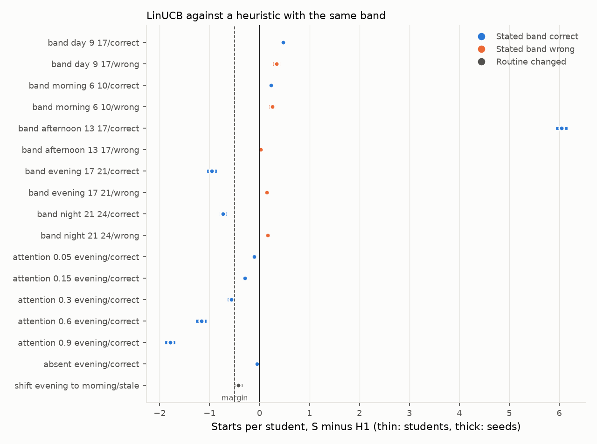
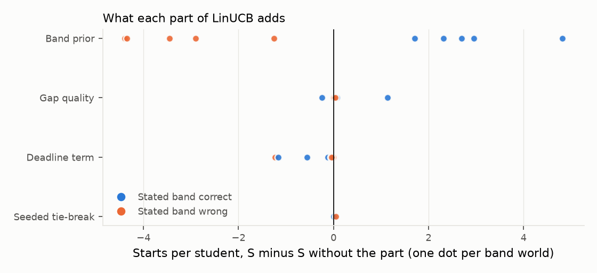
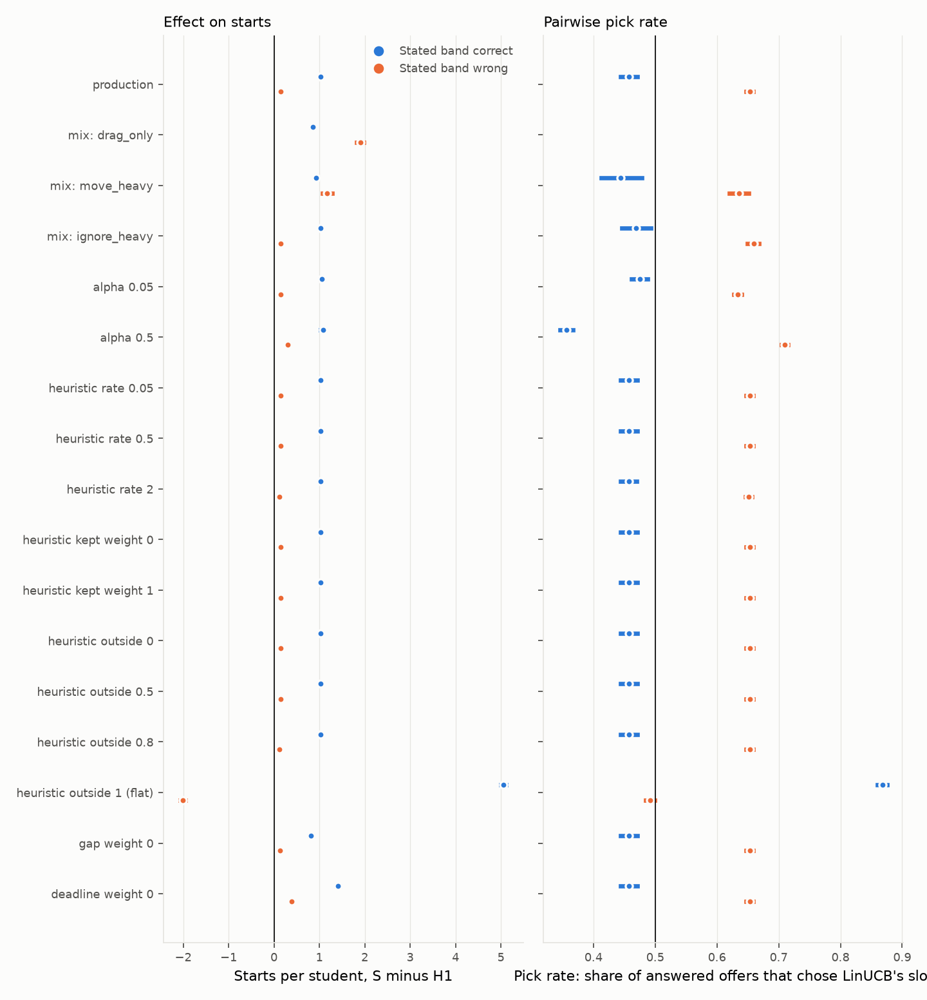

# Report: heuristic vs LinUCB, offline eval with a same-band control

**Context.** Zenflow is a study planner. When a student adds a task or a new exam or assignment arrives, the app
places a session for it and may offer one alternative time. The student can start the session, ignore it,
move it, or tap the alternative. Before release we want to know whether the learning policy (LinUCB) places
sessions better than the rule-based one (the heuristic).

We compared them with simulated students, because the live test has too few users to decide this early
([A/B plan](./ab-testing.md)). The question is the fair one: LinUCB uses the focus band the student states at
onboarding, so the heuristic gets the same band.

1. **Heuristic (H1):** a table of favourite hours, seeded from the stated band, that learns from what the student does.
2. **LinUCB (S):** a learning method with one model per time band, a prior from the stated band, and two slot-level
   terms (free time around the slot, distance to the deadline). It is the version in production
   ([level-up report](./level-up-linucb-v2.md)).

## Glossary

Read this first. Every table in the report uses these terms.

**The students**

- **Simulated student:** a program that reacts to placements by fixed rules. There are no real people in this report.
- **True band:** the hours the student really starts in, for example 17:00 to 21:00.
- **Stated band:** the answer given at onboarding to "when do you focus best?": morning, afternoon, evening or late night. Both policies use it.
- **Correct** means the stated band matches the true band (a 17 to 21 student says "evening"). **Wrong** means it does not (the same
  student says "morning"). Both are tested, because real students may misreport.
- **Attention** is the chance that the student opens the Zenflow app during a block's time slot. It is not focus. A start is counted
  when the app is opened in the block, so attention 0.5 means about half of the blocks can start and 0.05 almost none. Within 2 days of a
  deadline the chance is multiplied by 1.5 (capped at 1).
- **Drag, tap, ignore** are how a student treats a proposal: move a bad block, answer the "keep or prefer this time?" offer, or do nothing.
- **World:** one kind of simulated student: a true band, a stated band and an attention level.

**The policies and bounds**

- **H0:** the rule-based policy (the heuristic) with the default favourite-hours table. It stands for a student who skipped onboarding.
- **H1:** the heuristic started from the stated band. It is the fair rival, because it gets the same information as LinUCB.
- **L0:** LinUCB with no stated band. **S:** LinUCB with the stated band, as shipped. S-gap, S-deadline and S-tiebreak are S with one part switched off.
- **Oracle:** the best possible placement for the student (the ceiling). **Rand:** a random placement (the floor).

**The outcomes**

- **Proposal / event:** one slot the app places for one task.
- **Start:** the student opens the app in a block that lies in their true band. It is the only outcome this eval counts.
- **Pick rate:** among offers the student answered, the share where they chose LinUCB's time rather than the heuristic's.
  50% means no preference. "Pick rate, wrong band" is that share in the worlds where the stated band is wrong.

## 1. The answer in short

Starts per student over 4 weeks (12 tasks), held-out seeds, 3,000 students per world:

| | Worlds | Result |
| --- | --- | --- |
| LinUCB clearly better than H1 | 8 of 17 | three correct-band worlds (09 to 17, 06 to 10, 13 to 17) and all five wrong-band worlds (13 to 17 by only 0.03) |
| LinUCB slightly worse (under 0.5 starts) | 4 of 17 | very low attention, absent, routine change |
| LinUCB worse (past the margin) | 5 of 17 | evening and night students with a correct band, attention 0.3 and above |

- **No overall win over the fair control.** LinUCB gains up to +6.05 starts in one world (afternoon, correct band) and
  loses up to 1.79 in another (attention 0.9). The worlds are chosen, so they are not averaged into one number.
- **The band prior is what LinUCB adds.** It is worth +1.7 to +4.8 starts when the band is right and costs
  1.3 to 4.4 when it is wrong. Without it (L0), LinUCB is behind H1 in four of the five correct-band worlds.
- **LinUCB loses where the heuristic is already near its best.** At attention 0.9 the heuristic starts 11.28 tasks and
  LinUCB 9.49, about 16% fewer.
- **The deadline term costs starts here.** Removing it helps in 13 of 17 worlds and never hurts by more than 0.01. Without it, LinUCB beats H1 in four of the five correct-band worlds.
- **The pick rate agrees with the start result in most worlds.** LinUCB's option is taken 21% to 28% of the time where it
  loses on starts (evening, night, high attention) and 91% where it wins (afternoon). It disagrees in 2 of 5 correct-band worlds.
- **More students do not change this.** A 600-student run gives the same picture: 15 of 17 verdicts are identical and the intervals are 2.2 times wider (section 5.7).
- **Limit:** the students are invented. The results show how the policies behave under stated assumptions, not
  that real students will start more. Section 7 lists the limits.

## 2. The two systems

**Heuristic (H1).**

- Keeps one liking score per weekday and hour (7 x 24 cells) and proposes the free slot with the best score.
- It starts from the stated band: 1.0 for the hours inside it, 0.2 elsewhere. H0 is the same heuristic with the
  default table (09:00 to 12:00 scores 1.0, 14:00 to 17:00 scores 0.5, 19:00 to 22:00 scores 0.2, the rest 0).
  H0 stands for a student who skipped onboarding.
- A drag moves the table toward the new hour. A start raises that hour by 0.25 of a start reward.

**LinUCB (S).**

- Six time bands: 00 to 08, 08 to 11, 11 to 14, 14 to 17, 17 to 20, 20 to 24. One small model per band predicts how
  well a task placed there goes, from days to the deadline, task length, how busy the day is and the weekday.
- **Prior.** The stated band seeds each band model before any data: bands inside it start at +0.5, bands outside at
  -0.2, worth 3 pseudo-observations.
- **Slot score.** Band prediction plus an uncertainty bonus (alpha 0.15), plus 0.2 x gap quality (free time on each
  side of the slot, up to an hour each), minus up to 0.2 as the slot nears the deadline (within 24 hours).
  Ties between bands break in a seeded order.
- **Rewards (ADR-0035).** A start gives +1. A move gives minus the drag in minutes over 240, capped at -1. Ignoring
  gives nothing. In the pairwise offer, taking or keeping LinUCB's option gives +0.5 and keeping the heuristic's
  option over it gives -0.2.
- Quiet hours (23:00 to 06:00) are a hard limit. For a late-night student they are 02:00 to 09:00.

**Controls.**

- L0: LinUCB with no stated band. S-gap, S-deadline, S-tiebreak: S with that part switched off.
- Oracle: the in-band free slot with the best chance of a start. Rand: a random day and hour in the task's window.
- AB: the live protocol (section 4).

## 3. How to read the numbers

### 3.1 The metrics, defined exactly

Every number in this report is one of the six below. "Event" means one task placed for one student.

| Metric | Exact definition | Worked example | Better is |
| --- | --- | --- | --- |
| **Starts per student** | For one student and one policy: the number of that student's 12 tasks that end in a started block. A block is started when it lies in the student's true band and the student opens the app in it. The cell is the mean over students. | A student gets 12 tasks. 7 end in a started block, so the score is 7. | higher |
| **S − H1** (and every other "A − B") | For each student, policy A's score minus policy B's score on the same tasks and the same random draws, then the mean over students. | S scores 6.2 and H1 7.1 on average, so S − H1 is −0.9: LinUCB starts 0.9 fewer of the 12 tasks. | above 0 favours A |
| **Offered rate** | Events where the two policies propose starts at least 60 minutes apart, divided by all events. Only then does the student see a choice. | 92 of 100 events offered: 92%. | not a quality measure |
| **Tapped rate** | Offers the student answered, divided by offers shown. Only *tap* students answer (60% of students), and only when they see the offer (chance equal to their attention). | 37 of 100 offers answered: 37%. | not a quality measure |
| **Pick rate** (LinUCB pick rate) | Among answered offers, the share where the student chose LinUCB's slot rather than the heuristic's. | 37 offers answered, 11 chose LinUCB's slot: 30%. A pick rate of 50% means no preference. | above 50% favours LinUCB |
| **Start, LinUCB primary** and **Start, heuristic primary** | Among events where that policy was the primary (the one the app applies unless the student taps the other), the share whose applied block was started. | 100 events with LinUCB primary, 52 started: 52%. | higher |

Notes on the definitions:

- **Primary policy** is chosen by a seeded 50/50 coin per event, as in the live test. The applied block is the primary's slot, or the other
  policy's slot if the student tapped it. "Start by primary" therefore includes the effect of taps.
- **Pick rate is the stated-preference metric.** It is the simulated version of the classroom labelling session and the live pick rate.
  Its value depends on the assumed choice model (section 4), so read it as a consistency check on the start results, not as a result.
- The pick rate is a share of answered offers only. At attention 0.05 few offers are answered (4%), so its interval is wide.

### 3.2 Worlds, and "stated band correct" or "wrong"

- A **world** is one kind of simulated student: a true band, a stated band and an attention level (section 4 lists all 17).
- The **true band** is the hours the student really starts in. The **stated band** is what the app was told at onboarding. It is one of four:
  morning (08 to 12), afternoon (12 to 17), evening (17 to 21), late night (21 to 02).
- **Correct** means the stated band whose centre is nearest the true centre. **Wrong** means the farthest. Example: true band 17 to 21;
  correct is evening, wrong is morning.
- A phrase such as "pick rate, wrong band" means the pick rate in the worlds whose stated band is wrong. In the sensitivity table
  it is the pick rate over the five band worlds with a wrong stated band, taken together.

### 3.3 Intervals and how to read a table cell

A difference reads `mean [95% CI over students] / [95% CI over seeds]`. Example: `+0.47 [+0.44, +0.49] / [+0.44, +0.49]` means S starts
0.47 more tasks per student than H1; resampling students gives 0.44 to 0.49; resampling the 30 runs gives 0.44 to 0.49.

- **Over students:** resample the 3,000 students of a world 2,000 times. It shows how much the mean changes with a different draw of students.
- **Over seeds:** resample the 30 per-seed means 2,000 times. It covers run-to-run spread in the students and the learners.
- Both policies run on the same students, tasks and draws, so each difference is paired.
- Pick rates and offer rates use a bootstrap by student, since one student's answers are correlated.
- Absolute values (a policy's own starts per student) have no interval. Differences do.

### 3.4 Verdict, and why worlds are not averaged

- The margin is 0.5 starts per student (about one task in 24). It is a judgement of what a student would notice.
- **Verdict** uses the wider of the two intervals. *Better*: both ends above 0. *Worse*: both ends below 0 and the lower end past -0.5.
  *Slightly worse*: both ends below 0 and the lower end within -0.5. *Level*: the interval includes 0.
- The 17 worlds are chosen to probe the policies, not sampled from a population, so they are not averaged into one headline.
  The sensitivity table (section 5.6) is the one place worlds are averaged, and it says so.

## 4. How we tested

**Run.** Seeds 0 to 29, 100 students per seed (3,000 per world), on bandit code `f5d7155a`. A 600-student run of the same seeds (code `7a471847`) is the size check in
section 5.7. Sensitivity: seeds 100 to 109, 100 students per seed (1,000 per world). No constant was tuned; the Oracle and calendar were fixed on seeds 100 to 103.

**Worlds (17).**

| Group | Worlds |
| --- | --- |
| Band grid (10) | true bands 09 to 17, 06 to 10, 13 to 17, 17 to 21, 21 to 24, each with a correct and a wrong stated band |
| Attention sweep (5) | evening student, correct band, chance to open the app in a slot 0.05, 0.15, 0.3, 0.6, 0.9 |
| Absent (1) | evening student, attention 0.02 |
| Routine change (1) | evening student whose band moves to 06 to 10 after two weeks, stated band unchanged |

- Correct means the stated band whose centre is nearest the true centre. Wrong means the farthest.
- Attention is 0.5 in the band grid. It is raised to 1.5 times that within 2 days of a deadline.

**Tasks and calendar.**

- 12 tasks over 4 weeks. Each arrives at 08:00 on a random day, lasts 60 minutes, and is due 1, 2, 3, 5 or 7 days later.
- Each student has a weekday lecture timetable: 1 to 3 of three bands (07:30 to 11:15, 13:00 to 16:30, 16:45 to 20:00) with four 50-minute
  periods each, the same every week. Lectures are busy time. Placed tasks do not occupy the calendar.

**Student reaction (the assumption that matters most).**

- A student starts a block that lands in their true band if they open the app, with the chance above. Outside the band
  nothing happens, so ignoring gives no signal.
- Each student is one of three kinds, drawn once: *drag* (moves an out-of-band block to the nearest free in-band start 30% of
  the time), *tap* (answers offers), *ignore*. The headline mix is 10% drag, 60% tap, 30% ignore, the lazy-student mix of the
  level-up report. The sensitivity run varies it.

**The live protocol (AB).** Per event: a seeded coin picks the primary policy, both policies place the task, and an offer
appears when the two starts are at least 60 minutes apart. A tapper who sees it (chance equal to the open chance) compares
the two options by how close each is to their band, with noise 0.3 and a pull of 0.15 toward the primary. Closing the
offer keeps the primary. Learning follows the backend:

| Event | Effect on LinUCB |
| --- | --- |
| Takes LinUCB's option (either primary) | +0.5 |
| Keeps the heuristic's option over LinUCB's | -0.2, and the kept hour is reinforced |
| Takes the heuristic's option when LinUCB was primary | the move reward by distance |
| Start or move on LinUCB's slot | +1, or the move reward |

The noise and the pull are assumptions until the classroom labels exist.

**Gates run before any result is read** (`tests/test_evalx.py`): the harness places what `/v1/place` places; rewards equal the
backend constants; a seed reruns identically; an arm against itself differs by exactly 0; Oracle is at least every arm; Rand is
below S; with no bias the pick is 50%.

## 5. Results

### 5.1 LinUCB (S) against the heuristic with the same band (H1)

**What this measures.** Metric: starts per student, S minus H1. Compared against: H1, the heuristic started from the same stated band, on the same students, tasks and random draws. Question: does LinUCB place better than a rule-based policy that knows the same thing?

| World | H1 | S | S - H1 | Verdict |
| --- | --- | --- | --- | --- |
| 09 to 17, correct | 7.20 | ***7.67*** | +0.47 [+0.44, +0.49] / [+0.44, +0.49] | better |
| 09 to 17, wrong | 0.23 | ***0.57*** | +0.34 [+0.30, +0.38] / [+0.30, +0.38] | better |
| 6 to 10, correct | 6.03 | ***6.26*** | +0.23 [+0.21, +0.24] / [+0.21, +0.24] | better |
| 6 to 10, wrong | 0.23 | ***0.49*** | +0.26 [+0.22, +0.29] / [+0.22, +0.29] | better |
| 13 to 17, correct | 0.17 | ***6.22*** | +6.05 [+5.97, +6.13] / [+5.96, +6.13] | better |
| 13 to 17, wrong | 0.12 | ***0.15*** | +0.03 [+0.01, +0.04] / [+0.01, +0.04] | better |
| 17 to 21, correct | ***7.20*** | 6.24 | -0.96 [-1.01, -0.90] / [-1.02, -0.90] | worse |
| 17 to 21, wrong | 0.24 | ***0.39*** | +0.15 [+0.12, +0.17] / [+0.13, +0.17] | better |
| 21 to 24, correct | ***7.20*** | 6.47 | -0.73 [-0.77, -0.68] / [-0.77, -0.69] | worse |
| 21 to 24, wrong | 0.24 | ***0.41*** | +0.17 [+0.14, +0.19] / [+0.14, +0.19] | better |
| attention 0.05 | ***0.71*** | 0.61 | -0.11 [-0.12, -0.09] / [-0.12, -0.09] | slightly worse |
| attention 0.15 | ***2.16*** | 1.87 | -0.29 [-0.32, -0.26] / [-0.31, -0.27] | slightly worse |
| attention 0.3 | ***4.29*** | 3.73 | -0.57 [-0.61, -0.53] / [-0.61, -0.53] | worse |
| attention 0.6 | ***8.64*** | 7.48 | -1.16 [-1.23, -1.10] / [-1.24, -1.10] | worse |
| attention 0.9 | ***11.28*** | 9.49 | -1.79 [-1.85, -1.73] / [-1.86, -1.72] | worse |
| absent | ***0.23*** | 0.19 | -0.05 [-0.05, -0.04] / [-0.05, -0.04] | slightly worse |
| routine change | ***3.72*** | 3.30 | -0.42 [-0.46, -0.39] / [-0.47, -0.38] | slightly worse |

Worlds with a wrong band and a student whose band the table cannot reach score near 0 for both policies, so their
differences are small in size even when clear.

### 5.2 Against the default heuristic (H0) and the controls

**What this measures.** Metric: starts per student, S minus H0, with L0, Oracle and Rand as reference points. Compared against: H0 (default table, no band). Oracle is the ceiling, Rand the floor. Question: how much of LinUCB's gain comes from knowing the band, and where each policy sits between floor and ceiling?

S minus H0 is the value of the band plus the value of LinUCB. S minus H1 above isolates LinUCB.

| World | H0 | L0 | Oracle | Rand | S - H0 |
| --- | --- | --- | --- | --- | --- |
| 09 to 17, correct | 6.83 | 4.96 | 9.02 | 4.66 | +0.84 [+0.80, +0.88] |
| 6 to 10, correct | 6.04 | 3.94 | 9.02 | 1.36 | +0.23 [+0.21, +0.24] |
| 13 to 17, correct | 0.94 | 1.40 | 7.07 | 2.37 | +5.28 [+5.20, +5.36] |
| 17 to 21, correct | 0.96 | 3.29 | 9.02 | 2.49 | +5.29 [+5.21, +5.36] |
| 21 to 24, correct | 0.25 | 4.76 | 9.02 | 0.82 | +6.22 [+6.15, +6.29] |
| 09 to 17, wrong | 6.83 | 4.96 | 9.02 | 4.66 | -6.26 [-6.34, -6.17] |
| 6 to 10, wrong | 6.04 | 3.94 | 9.02 | 1.36 | -5.55 [-5.63, -5.46] |

- Against H0, LinUCB with a correct band gains 5.3 to 6.2 starts for afternoon, evening and night students, and about
  0.2 to 0.8 for students whose hours the default table already covers (06 to 10, 09 to 17).
- With a wrong band it loses 5.6 to 6.3 against H0 where H0's default table already fits. The cost of a wrong stated band falls on
  LinUCB and H1 alike (section 5.1).
- Oracle is the ceiling in every world, which the gates check.

### 5.3 Every arm, starts per student

**What this measures.** Metric: starts per student for every arm. Compared against: no difference is taken. Read each row against Rand (floor) and Oracle (ceiling). Question: is every policy at least better than random, and how far is the best from the ceiling?

Oracle is the ceiling and Rand the floor. Bold italic is the best of the seven policy arms in a row. S-gap, S-deadline and
S-tiebreak are S with that part off. Intervals for the differences are in sections 5.1 and 5.4 and in the eval output.

| World | H0 | H1 | L0 | S | S-gap | S-deadline | S-tiebreak | Oracle | Rand |
| --- | --- | --- | --- | --- | --- | --- | --- | --- | --- |
| 09 to 17, correct | 6.83 | 7.20 | 4.96 | 7.67 | 7.65 | ***7.73*** | 7.67 | 9.02 | 4.66 |
| 09 to 17, wrong | ***6.83*** | 0.23 | 4.96 | 0.57 | 0.51 | 0.56 | 0.57 | 9.02 | 4.66 |
| 6 to 10, correct | 6.04 | 6.03 | 3.94 | 6.26 | 6.26 | ***6.82*** | 6.26 | 9.02 | 1.36 |
| 6 to 10, wrong | ***6.04*** | 0.23 | 3.94 | 0.49 | 0.48 | 1.72 | 0.50 | 9.02 | 1.36 |
| 13 to 17, correct | 0.94 | 0.17 | 1.40 | 6.22 | 6.15 | ***6.34*** | 6.22 | 7.07 | 2.37 |
| 13 to 17, wrong | 0.94 | 0.12 | ***1.40*** | 0.15 | 0.14 | 0.15 | 0.14 | 7.07 | 2.37 |
| 17 to 21, correct | 0.96 | ***7.20*** | 3.29 | 6.24 | 6.48 | 6.30 | 6.24 | 9.02 | 2.49 |
| 17 to 21, wrong | 0.96 | 0.24 | ***3.29*** | 0.39 | 0.38 | 0.40 | 0.35 | 9.02 | 2.49 |
| 21 to 24, correct | 0.25 | 7.20 | 4.76 | 6.47 | 5.33 | ***7.64*** | 6.47 | 9.02 | 0.82 |
| 21 to 24, wrong | 0.25 | 0.24 | ***4.76*** | 0.41 | 0.37 | 0.45 | 0.36 | 9.02 | 0.82 |
| attention 0.05 | 0.08 | ***0.71*** | 0.14 | 0.61 | 0.67 | 0.61 | 0.61 | 0.89 | 0.25 |
| attention 0.15 | 0.28 | ***2.16*** | 0.61 | 1.87 | 2.01 | 1.88 | 1.87 | 2.69 | 0.74 |
| attention 0.3 | 0.57 | ***4.29*** | 1.60 | 3.73 | 3.94 | 3.75 | 3.73 | 5.37 | 1.48 |
| attention 0.6 | 1.14 | ***8.64*** | 4.24 | 7.48 | 7.75 | 7.54 | 7.48 | 10.83 | 2.97 |
| attention 0.9 | 1.30 | ***11.28*** | 5.76 | 9.49 | 9.69 | 9.52 | 9.49 | 12.00 | 3.59 |
| absent | 0.02 | ***0.23*** | 0.03 | 0.19 | 0.21 | 0.19 | 0.19 | 0.23 | 0.07 |
| routine change | 3.44 | ***3.72*** | 2.68 | 3.30 | 3.48 | 3.61 | 3.30 | 9.02 | 1.95 |

- Below Rand with a correct band: H0 in the afternoon, evening and night worlds, and H1 and L0 in the afternoon world.
- With a wrong band, H1 and every S variant fall below Rand in every world except S-deadline in the 06 to 10 world (1.72 against 1.36), since they follow the wrong hours. L0 does not use the band.
- S-deadline is the best policy arm in four correct-band worlds (09 to 17, 06 to 10, 13 to 17, 21 to 24) and beats H1 in each.
  H1 stays best in the evening world and in the attention, absent and routine-change worlds.
- S-gap differs from S by under 0.3 except in the night world (5.33 against 6.47). S-tiebreak differs by under 0.1 everywhere.
- H1 and H1-deadline score the same in every world, so the deadline term does nothing to the heuristic and the S-deadline gain is LinUCB's own.
- Only H1 in the absent world matches Oracle (0.23). In the correct-band worlds the best arm is 0.2 to 5.3 starts below it,
  and the routine-change world is the widest.

### 5.4 What each part of LinUCB adds

**What this measures.** Metric: starts per student, S minus S with one part switched off (the prior is switched off by comparing S with L0). Compared against: S itself, one part at a time. Question: which part of LinUCB earns its place, and which costs starts?

Starts per student, S minus S without the part. Rows for the five correct-band worlds; the figure includes the wrong-band worlds.

| World | Prior (S - L0) | Gap quality | Deadline term | Tie-break |
| --- | --- | --- | --- | --- |
| 09 to 17 | +2.70 | +0.01 | -0.06 | 0.00 |
| 6 to 10 | +2.32 | 0.00 | -0.56 | 0.00 |
| 13 to 17 | +4.82 | +0.07 | -0.12 | 0.00 |
| 17 to 21 | +2.95 | -0.24 | -0.06 | 0.00 |
| 21 to 24 | +1.71 | +1.14 | -1.17 | 0.00 |
| attention 0.9 | +3.73 | -0.20 | -0.02 | 0.00 |
| routine change | +0.62 | -0.18 | -0.31 | 0.00 |

Every world and every interval is in the eval output (`evalx/out/report.md`).

- **Prior:** positive with a correct band in all 5 worlds (+1.7 to +4.8), negative with a wrong band in all 5 (-1.3 to -4.4).
- **Gap quality:** near 0 in most worlds, +1.14 for the night student, -0.24 for the evening student and -0.20 at attention 0.9.
- **Deadline term:** interval below 0 in 13 of 17 worlds; never positive beyond +0.01.
- **Tie-break:** 0.00 with a correct band, within 0.05 of 0 with a wrong one.

### 5.5 Pairwise offer

**What this measures.** Metric: offered rate, tapped rate, pick rate, and start by primary policy. Compared against: a pick rate of 50% (no preference), and the start rate of the other primary policy. Question: when a student states a choice between the two policies' times, does it agree with the start results?

Definitions are in section 3.1. Rates are over events for "Offered", over offers for "Tapped", and over answered offers for "LinUCB pick rate".

| World | Offered | Tapped | LinUCB pick rate | Start, LinUCB primary | Start, heuristic primary |
| --- | --- | --- | --- | --- | --- |
| 09 to 17, correct | 83% | 35% | 47% [45, 48] | 63% | 60% |
| 6 to 10, correct | 78% | 38% | 38% [37, 39] | 50% | 52% |
| 13 to 17, correct | 94% | 37% | 91% [90, 91] | 51% | 20% |
| 17 to 21, correct | 91% | 37% | 27% [26, 28] | 54% | 60% |
| 21 to 24, correct | 53% | 40% | 21% [20, 22] | 55% | 60% |
| attention 0.05 | 90% | 4% | 34% [31, 37] | 5% | 6% |
| attention 0.9 | 92% | 57% | 27% [26, 28] | 88% | 94% |
| routine change | 92% | 37% | 51% [50, 52] | 34% | 34% |
| 09 to 17, wrong | 61% | 39% | 74% [73, 74] | 14% | 9% |

- Where LinUCB wins on starts (afternoon) its option is taken 91% of the time. Where it loses (evening, night, high attention) it is taken 21% to 28%.
- 06 to 10 and 09 to 17 disagree: LinUCB wins on starts but its option is taken only 38% and 47% of the time.
- Most offers are not tapped. At attention 0.05 only 4% of offers are tapped, so few picks reach LinUCB.
- With a wrong band both policies are poor, and LinUCB's option is taken 61% to 74% of the time. It is the less bad option.

### 5.6 Sensitivity to the assumptions

**What this measures.** Metric: S minus H1 in starts per student, and the pick rate. Compared against: the production row, changing one assumption per row. Question: does the verdict survive different student behaviour, LinUCB settings and heuristic settings?

Each row changes one assumption from the production row. Seeds 100 to 109, 1,000 students per world. Intervals are over students.

- **Correct-band worlds** here are the five band worlds (true bands 09 to 17, 06 to 10, 13 to 17, 17 to 21, 21 to 24) with a correct stated band.
  **Wrong-band worlds** are the same five with a wrong stated band.
- **S − H1** is the mean over those five worlds (equal weight), in starts per student.
- **Pick rate** is the share of answered offers where the student chose LinUCB's slot, over the same five worlds taken together (section 3.1).
- Averages hide which world drives them. In the production row the correct-band average of +1.03 is carried by one world (afternoon, +6.05), so
  compare rows with each other and do not read the level.

| Row | What changes | S - H1, correct-band worlds | S - H1, wrong-band worlds | Pick rate, correct-band worlds | Pick rate, wrong-band worlds |
| --- | --- | --- | --- | --- | --- |
| production | Production settings: 10% drag, 60% tap, 30% ignore; LinUCB alpha 0.15; heuristic as shipped | +1.03 [+0.99, +1.07] | +0.15 [+0.11, +0.19] | 46% [44, 47] | 65% [65, 66] |
| mix: drag_only | Every student is a dragger | +0.86 [+0.82, +0.90] | +1.90 [+1.83, +1.97] | n/a (no tappers) | n/a (no tappers) |
| mix: move_heavy | 60% drag, 10% tap, 30% ignore | +0.93 [+0.89, +0.97] | +1.17 [+1.08, +1.25] | 44% [41, 48] | 64% [62, 65] |
| mix: ignore_heavy | 10% drag, 20% tap, 70% ignore | +1.03 [+0.99, +1.07] | +0.15 [+0.11, +0.19] | 47% [45, 49] | 66% [65, 67] |
| alpha 0.05 | LinUCB exploration weight 0.05 (shipped 0.15) | +1.06 [+1.02, +1.10] | +0.15 [+0.11, +0.18] | 48% [46, 49] | 63% [63, 64] |
| alpha 0.5 | LinUCB exploration weight 0.5 | +1.08 [+1.04, +1.11] | +0.30 [+0.26, +0.34] | 36% [35, 37] | 71% [70, 72] |
| heuristic rate 0.05 | Heuristic table learning rate 0.05 (shipped 0.2) | +1.03 [+0.99, +1.07] | +0.15 [+0.11, +0.19] | 46% [44, 47] | 65% [65, 66] |
| heuristic rate 0.5 | Heuristic table learning rate 0.5 | +1.03 [+0.99, +1.07] | +0.15 [+0.11, +0.18] | 46% [44, 47] | 65% [65, 66] |
| heuristic rate 2 | Heuristic table learning rate 2 | +1.03 [+0.99, +1.07] | +0.12 [+0.09, +0.15] | 46% [44, 47] | 65% [65, 66] |
| heuristic kept weight 0 | A kept or started slot adds 0 to the table (shipped 0.25) | +1.03 [+0.99, +1.07] | +0.15 [+0.11, +0.19] | 46% [44, 47] | 65% [65, 66] |
| heuristic kept weight 1 | A kept or started slot adds 1 | +1.03 [+0.99, +1.07] | +0.15 [+0.11, +0.19] | 46% [44, 47] | 65% [65, 66] |
| heuristic outside 0 | H1 table value outside the stated band 0 (shipped 0.2) | +1.03 [+0.99, +1.07] | +0.15 [+0.11, +0.19] | 46% [44, 47] | 65% [65, 66] |
| heuristic outside 0.5 | H1 table value outside the stated band 0.5 | +1.03 [+0.99, +1.07] | +0.15 [+0.11, +0.19] | 46% [44, 47] | 65% [65, 66] |
| heuristic outside 0.8 | H1 table value outside the stated band 0.8 | +1.03 [+0.99, +1.07] | +0.12 [+0.09, +0.15] | 46% [44, 47] | 65% [65, 66] |
| heuristic outside 1 (flat) | H1 table value outside the band 1.0, the same as inside: the band is ignored | +5.05 [+4.98, +5.13] | -2.01 [-2.07, -1.95] | 87% [86, 88] | 49% [48, 50] |
| gap weight 0 | LinUCB gap-quality weight 0 (shipped 0.2) | +0.82 [+0.77, +0.86] | +0.13 [+0.10, +0.16] | 46% [44, 47] | 65% [65, 66] |
| deadline weight 0 | Deadline weight 0 for both policies (shipped 0.2) | +1.41 [+1.37, +1.45] | +0.40 [+0.35, +0.44] | 46% [44, 47] | 65% [65, 66] |

- **Student behaviour.** Starts follow the share of dragging students, because in the single-policy arms only draggers act.
  With all students dragging, LinUCB's lead over H1 is larger when the band is wrong (+1.90), since it learns from moves faster.
- **LinUCB settings.** Alpha 0.05 to 0.5 barely moves S − H1. Alpha 0.5 lowers the pick rate to 36% with a correct band.
- **Deadline weight 0** raises S − H1 by 0.38 (correct band) and 0.24 (wrong band). In the held-out run H1 scores the same with and without the term in every
  world (section 5.3 and the deadline-off table in the eval output), so the gain is LinUCB's.
- **Heuristic settings (rows "heuristic ...").** The learning rate (0.05 to 2), the weight of a kept slot (0 to 1) and the table value outside
  the band (0 to 0.8) change S − H1 by 0.03 or less. We checked the settings are wired: a rate of 5 or a flat table changes the outcome.
  Over 12 tasks the table moves one cell at a time, and the band's own hours already sit at the 1.0 cap, so moderate settings do not change what it proposes.
- **Flat table (outside 1).** Ignoring the stated band is the one heuristic setting that matters, and it trades one case for the other:
  S − H1 becomes +5.05 with a correct band (the heuristic has thrown the band away) and -2.01 with a wrong band (the heuristic no longer follows the wrong hours).
  No heuristic setting tested beats LinUCB with a correct band and also holds up with a wrong one.

### 5.7 Does the sample size matter?

**What this measures.** Metric: S − H1 in starts per student, and the width of its 95% interval over students. Compared against: the same
30 seeds with 600 students per world (an earlier run) and with 3,000 per world (this report's main run). Question: is the result limited by how many
students were simulated?

| World | S - H1, 3000 students | Width | Verdict | S - H1, 600 students | Width | Verdict |
| --- | --- | --- | --- | --- | --- | --- |
| 09 to 17, correct | +0.47 | 0.05 | better | +0.47 | 0.11 | better |
| 09 to 17, wrong | +0.34 | 0.08 | better | +0.34 | 0.19 | better |
| 6 to 10, correct | +0.23 | 0.04 | better | +0.25 | 0.09 | better |
| 6 to 10, wrong | +0.26 | 0.07 | better | +0.22 | 0.14 | better |
| 13 to 17, correct | +6.05 | 0.16 | better | +6.02 | 0.35 | better |
| 13 to 17, wrong | +0.03 | 0.03 | better | +0.02 | 0.07 | level |
| 17 to 21, correct | -0.96 | 0.11 | worse | -0.90 | 0.24 | worse |
| 17 to 21, wrong | +0.15 | 0.04 | better | +0.13 | 0.09 | better |
| 21 to 24, correct | -0.73 | 0.09 | worse | -0.73 | 0.21 | worse |
| 21 to 24, wrong | +0.17 | 0.05 | better | +0.15 | 0.11 | better |
| attention 0.05 | -0.11 | 0.03 | slightly worse | -0.10 | 0.07 | slightly worse |
| attention 0.15 | -0.29 | 0.06 | slightly worse | -0.23 | 0.12 | slightly worse |
| attention 0.3 | -0.57 | 0.08 | worse | -0.52 | 0.18 | worse |
| attention 0.6 | -1.16 | 0.12 | worse | -1.09 | 0.27 | worse |
| attention 0.9 | -1.79 | 0.12 | worse | -1.76 | 0.27 | worse |
| absent | -0.05 | 0.02 | slightly worse | -0.04 | 0.03 | slightly worse |
| routine change | -0.42 | 0.08 | slightly worse | -0.44 | 0.17 | worse |

- Width is the upper minus the lower end of the interval over students. It is 0.02 to 0.16 at 3,000 students and 0.03 to 0.35 at 600, about 2.2 times narrower.
- The means move by 0.07 or less.
- 15 of 17 verdicts are identical. Two change, both at a boundary: the 13 to 17 wrong-band world is level at 600 and better at 3,000 (+0.02 and +0.03, too
  small to matter), and the routine-change world is worse at 600 and slightly worse at 3,000 (-0.44 and -0.42, on the -0.5 margin).
- Counts at 3,000: better 8, slightly worse 4, worse 5, level 0. At 600: better 7, level 1, slightly worse 3, worse 6.
- More students narrow the intervals and leave the conclusions as they are. What limits the report is the assumed student, not the sample size.

## 6. What the results mean

**Why LinUCB beats the heuristic for an afternoon student.**

- The student's hours are 13:00 to 17:00. The stated afternoon band is 12:00 to 17:00, so H1's table is flat across it and
  can place tasks at 12:00, just before lectures at 13:00. Those blocks fall outside the student's band and do not start.
- LinUCB's band models learn the 14:00 to 17:00 band quickly. This is a probable cause; we did not test it.

**Why it loses for evening and night students and at high attention.**

- The heuristic with a correct band is already near its best in these worlds, and its table resolves single hours.
  LinUCB's bands are three to four hours wide and it explores, so a share of its first placements likely miss the
  student's hours. We did not test this.
- The loss grows with attention (-0.11 at 0.05 to -1.79 at 0.9), because the more the student opens the app the more each
  missed placement costs. It is a relative loss of about 16% at 0.9.

**The deadline term is the part most clearly doing harm.**

- It lowers starts by 0.3 to 1.2 in the morning, night and routine-change worlds and by under 0.2 elsewhere. A likely
  cause: the simulator raises the chance of opening the app near a deadline, which the term pushes against.
- That is a property of the assumed student. The term has not been checked against real behaviour.

**The prior matters in both directions.**

- A correct stated band is worth +1.7 to +4.8 starts. A wrong one costs 1.3 to 4.4 and hurts the heuristic just as much.
- If the stated band is often wrong, neither policy is safe. The onboarding question matters more than the choice of policy.

## 7. Verdict

**Do not claim LinUCB is better than a heuristic given the same band.** The offline eval supports a narrower statement:

- LinUCB is clearly better in 8 of 17 worlds and worse in 9 (5 past the margin, 4 within it).
- Its value comes from the stated-band prior. Giving the heuristic the same prior removes most of the gap, except in the afternoon world.
- It is worse for evening and night students, and for students who open the app often.
- The deadline term does not earn its place in this simulation. The gap term helps only the night student (+1.14) and is neutral or costs up to 0.27 elsewhere.

**What would change this:** a live pick rate well above 50% in the classroom session, or fitted student parameters that
move the pick-model assumptions. The sensitivity run says the start result moves with the share of students who drag.

**Limits.**

- The students are simulated. Band, attention, drag share and the pick model are assumptions, not fitted to data.
- The start label is binary: it does not model how late a student starts.
- Lectures fill the calendar. Exams, assignments and placed tasks do not.
- The stated band has four values; true bands are single ranges; worlds are chosen, not a sample of a population.
- 12 tasks per student over 4 weeks is a short horizon for a learner.
- The hybrid model is not included.
- The numbers reproduce from `uv run python -m evalx run --seeds 30 --students 100` on the bandit code at commit `f5d7155a`. Protocol: [eval-protocol.md](./eval-protocol.md).
